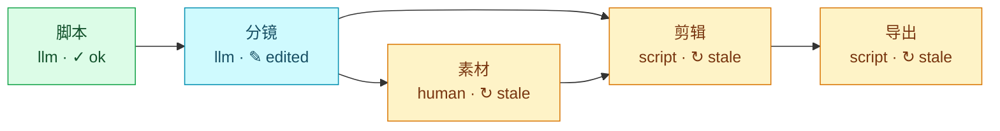

# Flowgit

**万物皆可流程化。** 把任何事情拆成一步一张卡片的可视化流程：每一步有产物、有版本，人和 AI 都能接手，做好的流程可以分享给别人 fork 复用。

**Turn anything into a flow.** Break any piece of work into visual stages: each stage has artifacts and versions, people and AI can both pick it up, and finished flows can be shared and forked.

> 状态：早期开发（spec v0.1）。目前有格式规范、核心库、命令行工具，以及本机看板（`flowgit board`，可查看、修改、运行、填写输入、看历史、对比和回退）。版本对比也可以在终端用 `flowgit diff`。
>
> Status: early (spec v0.1). The format, core library, CLI, and a local board (`flowgit board`: view, edit, run, fill in inputs, browse history, compare, and restore) are here. Version diffs are also available in the terminal with `flowgit diff`.

## 为什么 / Why

现在的 AI 工具要么是一键黑盒，要么是给工程师用的节点图。中间过程看不见、改不了、存不下来。Flowgit 把"做出来的过程"当成产品本身：

- **阶段看板**：脚本 → 分镜 → 素材 → 剪辑 → 导出，每一步一张卡，不是 200 个节点。
- **每一步都有版本**：改了分镜，后面需要重跑的阶段自动标出来；不满意随时回退。
- **人和 AI 混合**：一个阶段可以由模型做、由脚本做，也可以由人来做。
- **接任何模型**：Claude、GPT、GLM、DeepSeek、Kimi、通义千问、OpenRouter、本机 Ollama 都能接，流程里只写模型名。
- **接任何 agent**：一个阶段可以交给 Claude Code、Codex、Cursor、Gemini CLI 或你自己的 agent，它在流程目录里把产物写出来。
- **开放格式**：流程就是一个文件夹加一个 `flow.json`（也可以写成好读好改的 `flow.md`），可以放进 Git、分享、fork。
- **能导出成 Skill**：同一个流程可以生成 `SKILL.md`，让 Claude Code 这类工具直接按阶段跑。

Today's AI tools are either one-click black boxes or node graphs built for engineers. You can't see the steps in between, change them, or keep them. Flowgit treats the process of making something as the product itself:

- **Stage board**: script → storyboard → assets → edit → export. One card per step, not 200 nodes.
- **Every step is versioned**: change the storyboard and the stages that need a re-run are marked for you; roll back any time.
- **People and AI together**: a stage can be done by a model, by a script, or by a person.
- **Any model**: Claude, GPT, GLM, DeepSeek, Kimi, Qwen, OpenRouter or a local Ollama. The flow only names the model.
- **Any agent**: hand a stage to Claude Code, Codex, Cursor, Gemini CLI or your own agent, which writes the outputs in the flow directory.
- **Open format**: a flow is a folder with a `flow.json` (or a `flow.md`, easier to read and edit). Put it in Git, share it, fork it.
- **Exports to a Skill**: the same flow can generate a `SKILL.md` so tools like Claude Code can run it stage by stage.

自带的短视频模板跑完一遍、再手动改过分镜之后，`flowgit graph --status` 画出来是这样：分镜标成“手动修改”，下游三个阶段标成“需重跑”。

The bundled short-video template after one full run and a hand edit of the storyboard, as drawn by `flowgit graph --status`: the storyboard shows as edited and the three stages after it as stale.



## 快速开始 / Quick start

需要 Node.js 22+、[pnpm](https://pnpm.io)，导出视频需要 [FFmpeg](https://ffmpeg.org/download.html)。

You need Node.js 22+ and [pnpm](https://pnpm.io); exporting video needs [FFmpeg](https://ffmpeg.org/download.html).

```bash
git clone https://github.com/cgold9820-dotcom/Flowgit.git
cd Flowgit
pnpm install
pnpm build

# 用自带的短视频模板建一个流程 / create a flow from the short-video template
node packages/cli/dist/index.js init ~/my-video
cd ~/my-video
alias flowgit="node $OLDPWD/packages/cli/dist/index.js"

flowgit status                                   # 终端看板 / the terminal board
flowgit board --no-open                          # 本机网页看板：打开它打印的链接，按 Ctrl+C 停止再往下 / local web board: open the link it prints; Ctrl+C stops it
flowgit inputs set topic="为什么猫喜欢纸箱"         # 主题 / topic
flowgit inputs set language=en                   # 可选：zh（默认）或 en / optional: zh (default) or en
export ANTHROPIC_API_KEY=...                     # 脚本和分镜由 Claude 写 / Claude writes the script and storyboard
flowgit doctor                                   # 检查密钥和 FFmpeg 准备好了没有 / check the key and FFmpeg are ready
flowgit run all                                  # 跑到"素材"会停下等你 / stops at "assets" and waits for you
mkdir -p assets                                  # 放素材；空着也行，导出时用文字卡 / add assets, or leave empty for text cards
flowgit run all                                  # 剪辑 + 导出 → final.mp4 / edit + export → final.mp4
```

Windows PowerShell：

```powershell
git clone https://github.com/cgold9820-dotcom/Flowgit.git
cd Flowgit
pnpm install
pnpm build

$fg = "$PWD\packages\cli\dist\index.js"
function flowgit { node $fg @args }               # 这个窗口里可以直接用 flowgit / makes flowgit work in this window
flowgit init $HOME\my-video
cd $HOME\my-video

flowgit inputs set topic="为什么猫喜欢纸箱"
$env:ANTHROPIC_API_KEY = "..."                    # 或者换别的模型，见"接任何模型" / or another model, see "Any model"
flowgit doctor                                    # 检查密钥和 FFmpeg 准备好了没有 / check the key and FFmpeg are ready
flowgit run all
mkdir assets
flowgit run all
```

没有 API key，可以先用模板自带的示例回复试跑：

No API key yet? Try it with the template's bundled demo replies:

```bash
FLOWGIT_LLM_MOCK_DIR=demo-replies flowgit run all
# PowerShell: $env:FLOWGIT_LLM_MOCK_DIR = "demo-replies"; flowgit run all; Remove-Item Env:FLOWGIT_LLM_MOCK_DIR
```

`flowgit status` 的样子 / what the board looks like:

```text
短视频制作 · flow.json v0.1 · /home/me/my-video

#  阶段 stage       执行 executor  状态 state                  版本 runs  产物 outputs
1  脚本 script      llm            ✓ 已完成 (ok)               v1         script.md
2  分镜 storyboard  llm            ✎ 产物被手动修改 (edited)   v1         storyboard.json
3  素材 assets      human          ↻ 需重跑（上游或配置变了）  v1         assets
4  剪辑 edit        script         ↻ 需重跑（上游或配置变了）  v1         timeline.json
5  导出 export      script         ↻ 需重跑（上游或配置变了）  v1         final.mp4
```

命令行的提示和报错都是中英双语。模板生成的内容（脚本、字幕、提示）用你选的 `language`。

CLI messages and errors are bilingual. What a template produces (script, captions, its own messages) follows the `language` input you choose.

## 命令 / Commands

| 命令 / Command | 作用 | What it does |
| --- | --- | --- |
| `flowgit init [dir] [-t 模板\|目录\|Git 地址]` | 从模板、本地目录或 Git 地址新建流程。本地目录和 Git 默认不复制产物，`--with-outputs` 才复制；Git 可加 `--ref` 和 `--path` | Create a flow from a template, a local directory or a Git URL. A local directory or Git URL skips outputs unless `--with-outputs` is set; Git also takes `--ref` and `--path` |
| `flowgit share <目录> [--with-outputs] [--force]` | 复制一份可以分享的流程：默认不带产物，发现密钥就拒绝写入，邮箱和本机路径只提醒 | Copy a flow that is safe to share: outputs stay behind by default, a secret refuses the write, emails and local paths are warnings |
| `flowgit templates [--json]` | 列出自带的模板和它们的阶段 | List the bundled templates and their stages |
| `flowgit validate` | 按规范检查 `flow.json` 或 `flow.md` | Check `flow.json` or `flow.md` against the spec |
| `flowgit convert --to md\|json` | 在 `flow.json` 和 `flow.md` 之间转换，内容不变 | Switch between `flow.json` and `flow.md`; the flow stays the same |
| `flowgit stage add <id> --type <类型>` | 加一个阶段。没写 `--after` 就加在最后，没写 `--input` 就用前一个阶段；llm / agent 会建提示词骨架 | Add a stage. Omit `--after` to append, omit `--input` to use the previous stage; llm / agent gets a prompt skeleton |
| `flowgit stage rm <id> [--force]` | 删一个阶段，不删文件也不动 `runs/`。还有阶段依赖它时要 `--force` | Remove a stage without deleting files or `runs/`. `--force` when other stages depend on it |
| `flowgit status [--json]` | 看板：每个阶段的状态、版本、产物和下一步 | The board: each stage's state, version, outputs, and the next step |
| `flowgit board [--port 4747] [--no-open]` | 在浏览器打开本地看板（只监听 127.0.0.1），可查看和修改产物、运行阶段、填写输入、看历史、对比版本和回退 | Open a local board in the browser (listens on 127.0.0.1 only) to view and edit outputs, run stages, edit inputs, browse history, compare versions, and restore |
| `flowgit inputs` / `flowgit inputs set k=v` | 查看 / 填写流程输入 | Show / set flow inputs |
| `flowgit run <stage\|all>` | 跑一个阶段，或按顺序跑完所有需要跑的阶段 | Run one stage, or every stage that needs it, in order |
| `flowgit run all --dry-run` | 预演：列出每个阶段会跳过、运行还是停下等你，以及最多调用几次模型；什么都不运行 | Dry run: whether each stage would be skipped, run or stop for you, and at most how many model calls; nothing runs |
| `flowgit run <stage> --from <path>` | 人工阶段：把文件或文件夹放进产物位置 | Human stage: put a file or folder in place as the output |
| `flowgit log [stage]` | 这个阶段的历史版本；不写阶段就按时间列出整个流程的，并合计 token 用量 | The stage's version history; without a stage, the whole flow's by time, with a token total |
| `flowgit diff <stage> <a> [b] [--json]` | 对比两个版本的产物；省略 `b` 则和当前文件比 | Diff one version against another, or against the current files when `b` is omitted |
| `flowgit restore <stage> <n>` | 回退到某个版本 | Roll back to a version |
| `flowgit providers [--json]` | 列出模型供应商，以及密钥有没有设置（不显示密钥） | List model providers and whether each key is set (never the key) |
| `flowgit doctor [--model m] [--json]` | 跑之前检查这台电脑：Node、流程输入、密钥、脚本和 agent 要用的命令。不调用模型，不运行阶段 | Check this machine before a run: Node, flow inputs, keys, and the programs script and agent stages use. Calls no model and runs no stage |
| `flowgit graph [--status] [--md] [-o 文件]` | 把流程画成 Mermaid 流程图（GitHub、Obsidian 能直接显示），`--status` 按状态上色，`-o` 写成 UTF-8 文件 | Draw the flow as a Mermaid diagram (GitHub and Obsidian render it); `--status` colors it by state, `-o` writes a UTF-8 file |
| `flowgit export-skill [-o SKILL.md]` | 生成 `SKILL.md`，给 AI 工具用 | Generate a `SKILL.md` for AI tools |

所有命令都接受 `-C <dir>` 指定流程目录。`run` 还接受 `--input k=v`（只对这次运行生效）、`--model`、`--force` 和 `--dry-run`。`diff` 对文本和 JSON 按行输出 unified diff（`+` 绿色、`-` 红色，尊重 `NO_COLOR`），二进制只比较 sha256，文件夹列出新增、删除和改动的文件。

Every command accepts `-C <dir>` for the flow directory. `run` also takes `--input k=v` (this run only), `--model`, `--force` and `--dry-run`. `diff` prints a line-based unified diff for text and JSON (`+` green, `-` red, honoring `NO_COLOR`), compares binaries by sha256 only, and lists added, removed and changed files for directories.

## 自带模板 / Bundled templates

| 模板 / Template | 新建 / Create | 流程 / Flow |
| --- | --- | --- |
| `short-video`（默认 / default） | `flowgit init` | 脚本 → 分镜 → 素材 → 剪辑 → 导出 / script → storyboard → assets → edit → export |
| `weekly-report` | `flowgit init -t weekly-report` | 随手记（人）→ 周报草稿（模型）→ 检查（脚本）/ notes (person) → draft (model) → check (script) |
| `article` | `flowgit init -t article` | 大纲 → 正文 → 配图方案 → 照片 → 导出 / outline → draft → image plan → photos → export |
| `support-sop` | `flowgit init -t support-sop` | 资料（人）→ 汇总（脚本）→ 规程 → 用例 → 检查（模型）→ 技能（脚本）/ knowledge (person) → collect (script) → SOP → cases → check (model) → skill (script) |
| `job-application` | `flowgit init -t job-application` | 材料（人）→ 分析 → 简历和求职信（模型，并行）→ 检查（脚本）/ materials (person) → analysis → resume and cover letter (model, in parallel) → check (script) |
| `research-report` | `flowgit init -t research-report` | 子问题 → 资料（人）→ 提纲 → 带引用的报告（模型）→ 检查出处（脚本）/ questions → sources (person) → outline → cited report (model) → citation check (script) |
| `ecommerce-listing` | `flowgit init -t ecommerce-listing` | 商品资料（人）→ 卖点 → 标题 → 主图和详情页、客服问答（模型，并行）→ 检查（脚本）/ product facts (person) → selling points → titles → detail page and Q&A (model, in parallel) → check (script) |
| `slides` | `flowgit init -t slides` | 大纲 → 每页内容（模型）→ 网页幻灯片、可打印成 PDF（脚本）→ 检查（脚本）/ outline → slide content (model) → HTML deck that prints to PDF (script) → check (script) |
| `live-selling` | `flowgit init -t live-selling` | 商品资料（人）→ 流程表 → 话术和弹幕问答（模型，并行）→ 检查（脚本）/ product facts (person) → rundown → script and chat Q&A (model, in parallel) → check (script) |
| `short-drama` | `flowgit init -t short-drama` | 设定和人物 → 分集节拍 → 逐集剧本 → 审读（模型）→ 检查（脚本）/ bible and characters → episode beats → scripts → review (model) → check (script) |
| `lesson-plan` | `flowgit init -t lesson-plan` | 教学目标 → 评价任务 → 教案和分层练习（模型，并行）→ 练习单、答案和检查（脚本）/ objectives → assessment → plan and tiered exercises (model, in parallel) → worksheet, answer key and check (script) |
| `meeting-notes` | `flowgit init -t meeting-notes` | 转录（人）→ 整理 → 纪要 → 待办（模型）→ 检查（脚本）→ 会后邮件 / transcript (person) → clean → minutes → actions (model) → check (script) → follow-up |

图文模板按平台（小红书、公众号、博客）决定篇幅和语气，导出 `post.md` 和 `post.html`。说明见 [`packages/cli/templates/article/README.md`](packages/cli/templates/article/README.md)。客服 SOP 模板把你的资料整理成规程和测试用例，最后打包成 `skill/SKILL.md`，说明见 [`packages/cli/templates/support-sop/README.md`](packages/cli/templates/support-sop/README.md)。短视频见 [`packages/cli/templates/short-video/README.md`](packages/cli/templates/short-video/README.md)，周报入门见 [教程](docs/guide.md)。

The article template sets length and tone from the platform (Xiaohongshu, WeChat, blog) and exports `post.md` and `post.html`. See [`packages/cli/templates/article/README.md`](packages/cli/templates/article/README.md). The support-SOP template turns your notes into an SOP and test cases, then packages them as `skill/SKILL.md`; see [`packages/cli/templates/support-sop/README.md`](packages/cli/templates/support-sop/README.md). The short video is [`packages/cli/templates/short-video/README.md`](packages/cli/templates/short-video/README.md); the weekly-report starter is built in the [guide](docs/guide.md).

## 接任何模型 / Any model

llm 阶段的模型写成 `<provider>/<model>`，不写前缀就是 Claude。可以写在 `flow.json` 的 `model` 里，也可以只在这次运行用 `--model`，或者设环境变量 `FLOWGIT_MODEL`。

An llm stage's model is `<provider>/<model>`; no prefix means Claude. Put it in `model` in `flow.json`, pass `--model` for one run, or set `FLOWGIT_MODEL`.

```bash
export GLM_API_KEY=...                              # PowerShell: $env:GLM_API_KEY="..."
flowgit run all --model glm/glm-5.3                 # 智谱 GLM / Zhipu GLM
flowgit run all --model deepseek/deepseek-v4-pro    # 需要 DEEPSEEK_API_KEY / needs DEEPSEEK_API_KEY
flowgit run all --model ollama/qwen3:8b             # 本机 Ollama，不需要密钥 / local Ollama, no key
flowgit providers                                   # 看有哪些 provider、密钥设了没有 / see providers and key status
flowgit doctor --model glm/glm-5.3                  # 跑之前检查密钥、命令、代理 / check keys, programs and proxy before a run
```

内置 `anthropic`、`openai`、`openrouter`、`glm`、`deepseek`、`moonshot`、`qwen`、`ollama`。其他兼容 Anthropic 或 OpenAI 接口的服务，在 `~/.flowgit/providers.json` 里加一条就行。密钥只从环境变量读，不会写进任何文件，也不会进 `flow.json`，所以流程可以放心分享。

Built in: `anthropic`, `openai`, `openrouter`, `glm`, `deepseek`, `moonshot`, `qwen`, `ollama`. Any other service that speaks the Anthropic or OpenAI API is one entry in `~/.flowgit/providers.json`. Keys are read only from environment variables, never written to a file or to `flow.json`, so flows are safe to share.

每次调用模型后会显示这次用了多少 token；`run all` 调用了好几次时，最后再显示一个合计。`flowgit log <阶段>` 里每个版本也写着用量，`flowgit log` 不写阶段时会合计整个流程用掉的 token，方便估算花费。

After each model call Flowgit shows the tokens it used; when `run all` makes several calls it also prints a total. `flowgit log <stage>` lists the usage of every version too, and `flowgit log` without a stage adds up the tokens the whole flow has used, so you can estimate the cost.

用代理或 VPN 上网时：设置了 `HTTPS_PROXY` 就会走它；Windows 和 macOS 上打开了系统代理（比如代理软件的「系统代理」模式）也会自动用上，不用再设别的。`flowgit doctor` 会显示用的是哪个代理，不想走代理就设置 `FLOWGIT_PROXY=off`。需要 Node 22.21 以上或 24 以上。

Behind a proxy or VPN: Flowgit uses `HTTPS_PROXY` when it is set, and on Windows and macOS it also picks up the system proxy (such as a proxy app's "system proxy" mode), with nothing else to set. `flowgit doctor` shows which proxy it uses; set `FLOWGIT_PROXY=off` to skip it. Needs Node 22.21+ or 24+.

```json
{
  "providers": {
    "company": { "protocol": "openai", "baseUrl": "https://llm.example.com/v1", "apiKeyEnv": "COMPANY_LLM_KEY" }
  }
}
```

细节见 [docs/spec.md 的"模型供应商"](docs/spec.md#模型供应商--model-providers)。

Details: ["Model providers" in docs/spec.md](docs/spec.md#模型供应商--model-providers).

## 接任何 agent / Any agent

`agent` 阶段会在流程目录里以无界面模式启动一个 agent CLI。Flowgit 把提示词渲染好（填入流程输入、列出上游产物和要写出的文件）交给它，由 agent 自己写出产物，之后照常检查产物、存成版本。

An `agent` stage starts an agent CLI headless in the flow directory. Flowgit renders the prompt (flow inputs, upstream artifacts, the files to write) and hands it over; the agent writes the outputs itself, and Flowgit checks them and records a version as usual.

```json
{ "type": "agent", "agent": "claude-code", "prompt": "prompts/research.md" }
{ "type": "agent", "agent": "codex", "prompt": "prompts/research.md", "args": ["--model", "gpt-5"] }
{ "type": "agent", "agent": "custom", "prompt": "prompts/research.md", "command": "my-agent --prompt-file {{promptFile}}" }
```

内置 `claude-code`、`codex`、`cursor`、`gemini`，另外 `custom` 可以接任何命令。内置适配默认只给"能在流程目录里写文件"的最小权限，**不会加任何跳过所有权限的参数**。要放宽权限，需要自己在 `args` 里加，风险说明见 [docs/spec.md 的"agent 执行器"](docs/spec.md#agent-执行器--the-agent-executor)。

Built in: `claude-code`, `codex`, `cursor` and `gemini`, plus `custom` for any command. Built-in adapters give the agent the least permission that still lets it write files in the flow directory, and **never add a bypass-all-permissions flag**. Widening that is your call, in `args`; the risks are in ["The agent executor" in docs/spec.md](docs/spec.md#agent-执行器--the-agent-executor).

想马上试一下：[`examples/agent-page`](examples/agent-page) 让 Claude Code 写大纲、做一个单文件网页，再用脚本检查。用 Claude 订阅登录 Claude Code 就能跑，不需要 API key。

To try it now: [`examples/agent-page`](examples/agent-page) has Claude Code write an outline and a single-file web page, then checks the page with a script. A Claude subscription login for Claude Code is enough; no API key needed.

## 接任何 HTTP 服务 / Any HTTP service

`service` 阶段调用一个 HTTP 接口。`POST` 把流程输入和 1 MB 以内的文本上游产物发出去，`GET` 把流程输入放进查询参数。密钥放在请求头的 `{{env.变量名}}` 里，只从环境变量读，不写进文件。`timeoutSec` 默认 60 秒。`flowgit doctor` 会检查这些变量，`flowgit run all --dry-run` 会把这一步标成会运行。示例：[`examples/service-echo`](examples/service-echo)。

A `service` stage calls an HTTP endpoint. `POST` sends the flow inputs and text upstream outputs up to 1 MB; `GET` puts the flow inputs in the query string. Keys go in header values as `{{env.NAME}}`, read only from the environment and never written to a file. `timeoutSec` defaults to 60 seconds. `flowgit doctor` checks those variables, and `flowgit run all --dry-run` lists the stage as one that would run. Example: [`examples/service-echo`](examples/service-echo).

```json
{ "type": "service", "method": "POST", "url": "https://example.com/hook", "headers": { "Authorization": "Bearer {{env.ECHO_TOKEN}}" } }
```

## 格式 / Format

最小的 `flow.json`：

A minimal `flow.json`:

```json
{
  "format": "flowgit",
  "version": "0.1",
  "name": "写一篇文章",
  "inputs": {
    "topic": { "type": "string", "required": true },
    "language": { "type": "string", "enum": ["zh", "en"], "default": "zh" }
  },
  "stages": [
    {
      "id": "outline",
      "name": "大纲",
      "executor": { "type": "llm", "prompt": "prompts/outline.md" },
      "outputs": [{ "type": "text/markdown", "path": "outline.md" }]
    },
    {
      "id": "draft",
      "name": "初稿",
      "inputs": ["outline"],
      "executor": { "type": "llm", "prompt": "prompts/draft.md" },
      "outputs": [{ "type": "text/markdown", "path": "draft.md" }]
    },
    {
      "id": "review",
      "name": "人工审稿",
      "inputs": ["draft"],
      "executor": { "type": "human", "instructions": "改好后保存为 final.md" },
      "outputs": [{ "type": "text/markdown", "path": "final.md" }]
    }
  ]
}
```

同一个流程也可以写成 `flow.md`：每个 `## 阶段名 {#id}` 是一个阶段，配置写在 ```` ```flowgit ```` 代码块里，在 GitHub 上直接能读。`flowgit convert --to md` 会帮你转换，见 [docs/spec.md 的 flow.md 一节](docs/spec.md#flowmd)。

The same flow can be written as `flow.md`: each `## Stage name {#id}` is a stage with its settings in a ```` ```flowgit ```` block, readable right on GitHub. `flowgit convert --to md` converts it for you; see [the flow.md section of docs/spec.md](docs/spec.md#flowmd).

完整规范见 [docs/spec.md](docs/spec.md)，JSON Schema 在 [packages/core/schema/flow.schema.json](packages/core/schema/flow.schema.json)。

The full spec is in [docs/spec.md](docs/spec.md); the JSON Schema is [packages/core/schema/flow.schema.json](packages/core/schema/flow.schema.json).

想从零做一个自己的流程，跟着 [docs/guide.md](docs/guide.md) 做一遍（约 15 分钟，不需要 API key），做完的样子就是自带的 `weekly-report` 模板：`flowgit init ~/my-report -t weekly-report`。

To build your own flow from scratch, follow [docs/guide.md](docs/guide.md) (about 15 minutes, no API key needed); the finished flow is the bundled `weekly-report` template: `flowgit init ~/my-report -t weekly-report`.

## 仓库结构 / Repository layout

```text
packages/
  core/   @flowgit/core  格式、校验、版本记录、执行器 / format, validation, runs, executors
  cli/    flowgit        命令行工具和模板 / CLI and templates
    templates/             自带模板：short-video（短视频）、weekly-report（周报入门）、article（图文）、support-sop（客服 SOP）、job-application（求职材料）、research-report（调研报告）、ecommerce-listing（电商上架）、slides（演示稿）、live-selling（直播带货）、short-drama（短剧）、lesson-plan（备课）、meeting-notes（会议纪要）/ bundled templates: short-video, weekly-report (starter), article, support-sop, job-application, research-report, ecommerce-listing, slides, live-selling, short-drama, lesson-plan, meeting-notes
  web/    @flowgit/web   本机网页看板：查看、修改、运行、填写输入、看历史、对比和回退 / local web board: view, edit, run, fill in inputs, browse history, compare and restore
docs/
  spec.md                  格式规范 / format spec
  guide.md                 教程：动手做一个流程 / tutorial: build your own flow
  releasing.md             怎么发布到 npm / how to publish to npm
examples/                  只在仓库里的示例，比如 agent-page / repo-only examples such as agent-page
CHANGELOG.md               每个版本的更新记录 / what changed in each version
```

## 开发 / Development

```bash
pnpm install
pnpm build        # 编译所有包 / compile every package
pnpm typecheck
pnpm test         # 单元测试 + 命令行端到端测试 / unit tests + CLI end-to-end tests
```

端到端测试运行编译后的 `dist/`，所以要先 `pnpm build`；渲染视频的测试需要 FFmpeg，没装会自动跳过。

The end-to-end tests run the compiled `dist/`, so run `pnpm build` first. The video render test needs FFmpeg and is skipped without it.

GitHub 上的内容（提交信息、PR、文档）都写中英双语，中文在前。

Everything on GitHub (commit messages, PRs, docs) is bilingual, Chinese first.

## 路线图 / Roadmap

1. **格式 + 命令行**（本仓库现状，0.1.0 准备发布）：Flow 规范 v0.1，JSON 产物可以带 schema；十一个自带模板（短视频、周报入门、图文、客服 SOP、求职材料、调研报告、电商上架、PPT 演示稿、直播带货、竖屏短剧、老师备课）；llm 阶段接任何模型，agent 阶段接 Claude Code、Codex、Cursor、Gemini，service 阶段调用 HTTP 服务；script、agent 和 service 阶段可以设超时；`stage add` / `stage rm`、`diff`（版本对比）、`doctor`、`templates`、`graph`（流程图）等命令。更新记录见 [CHANGELOG.md](CHANGELOG.md)。
2. **阶段看板**：本机看板已经有了（`flowgit board`），每张卡能看产物、改、运行、看历史、对比和回退。实时更新也有了：SSE 的 `flow:changed`。下一步是在看板上加删阶段、看流程图和预演，然后是网站：在网上打开一个流程就是一块看板。
3. **发布与复用**：已经能从别人的流程开始（`flowgit init -t <Git 地址>`，默认不带产物），分享前自动去隐私（`flowgit share`）。下一步是画廊。
4. **更多领域**：更多模板（下一个是落地页网站，做网站现在有 `examples/agent-page` 示例）；短视频自动配音；`workflow` 执行器运行子流程；之后让作者把流程变成 MCP 服务供别人调用。

English:

1. **Format + CLI** (this repo today, 0.1.0 getting ready to ship): Flow spec v0.1, with optional schemas for JSON outputs; eleven bundled templates (short video, weekly-report starter, article posts, support SOP, job application, research report, e-commerce listing, slide deck, live selling, vertical short drama, lesson prep); llm stages on any model, agent stages on Claude Code, Codex, Cursor or Gemini, and service stages that call HTTP services; timeouts for script, agent and service stages; commands such as `stage add` / `stage rm`, `diff` (compare versions), `doctor`, `templates` and `graph` (a diagram of the flow). See [CHANGELOG.md](CHANGELOG.md) for details.
2. **Stage board**: the local board is here (`flowgit board`); each card lets you see its outputs, edit them, run, browse history, compare and restore. Live updates are in too: the SSE event `flow:changed`. Next on the board: add and remove stages, a flow graph view and dry-run previews. After that comes the web app: open a flow online and it is a board.
3. **Publish and reuse**: you can already start from someone else's flow (`flowgit init -t <Git URL>`, without their outputs by default) and strip private data before sharing (`flowgit share`). Next is a gallery.
4. **More domains**: more templates (a landing-page site is next; building a website has the `examples/agent-page` example today); automatic voiceover for short videos; a `workflow` executor that runs a sub-flow; later, authors can expose a flow as an MCP service for others to call.

## 许可证 / License

[Apache-2.0](LICENSE)
