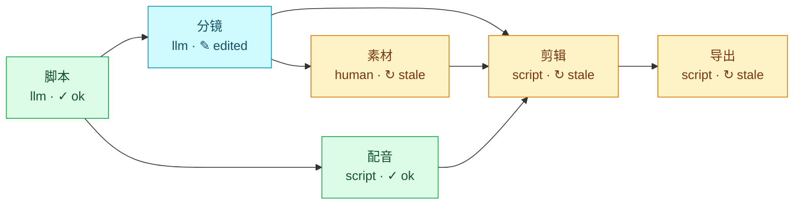

# Flowgit

**万物皆可流程化。** 把任何事情拆成一步一张卡片的可视化流程：每一步有产物、有版本，人和 AI 都能接手，做好的流程可以分享给别人 fork 复用。

**Turn anything into a flow.** Break any piece of work into visual stages: each stage has artifacts and versions, people and AI can both pick it up, and finished flows can be shared and forked.

> 状态：早期开发（spec v0.1）。目前有格式规范、核心库、命令行工具，以及本机看板（`flowgit board`，可查看、修改、运行、新增和删除阶段、填写输入、看历史、对比和回退，也可切换成流程图、预演全部运行、查看 token 用量）。版本对比也可以在终端用 `flowgit diff`。
>
> Status: early (spec v0.1). The format, core library, CLI, and a local board (`flowgit board`: view, edit, run, add and remove stages, fill in inputs, browse history, compare, restore, switch to a flow graph, preview a run, and see token usage) are here. Version diffs are also available in the terminal with `flowgit diff`.

## 为什么 / Why

现在的 AI 工具要么是一键黑盒，要么是给工程师用的节点图。中间过程看不见、改不了、存不下来。Flowgit 把"做出来的过程"当成产品本身：

- **阶段看板**：脚本 → 配音 → 分镜 → 素材 → 剪辑 → 导出，每一步一张卡，不是 200 个节点。
- **每一步都有版本**：改了分镜，后面需要重跑的阶段自动标出来；不满意随时回退。
- **人和 AI 混合**：一个阶段可以由模型做、由脚本做，也可以由人来做。
- **接任何模型**：Claude、GPT、GLM、DeepSeek、Kimi、通义千问、OpenRouter、本机 Ollama 都能接，流程里只写模型名。
- **接任何 agent**：一个阶段可以交给 Claude Code、Codex、Cursor、Gemini CLI 或你自己的 agent，它在流程目录里把产物写出来。
- **开放格式**：流程就是一个文件夹加一个 `flow.json`（也可以写成好读好改的 `flow.md`），可以放进 Git、分享、fork。
- **能导出成 Skill**：同一个流程可以生成 `SKILL.md`，让 Claude Code 这类工具直接按阶段跑。

Today's AI tools are either one-click black boxes or node graphs built for engineers. You can't see the steps in between, change them, or keep them. Flowgit treats the process of making something as the product itself:

- **Stage board**: script → voiceover → storyboard → assets → edit → export. One card per step, not 200 nodes.
- **Every step is versioned**: change the storyboard and the stages that need a re-run are marked for you; roll back any time.
- **People and AI together**: a stage can be done by a model, by a script, or by a person.
- **Any model**: Claude, GPT, GLM, DeepSeek, Kimi, Qwen, OpenRouter or a local Ollama. The flow only names the model.
- **Any agent**: hand a stage to Claude Code, Codex, Cursor, Gemini CLI or your own agent, which writes the outputs in the flow directory.
- **Open format**: a flow is a folder with a `flow.json` (or a `flow.md`, easier to read and edit). Put it in Git, share it, fork it.
- **Exports to a Skill**: the same flow can generate a `SKILL.md` so tools like Claude Code can run it stage by stage.

自带的短视频模板跑完一遍、再手动改过分镜之后，`flowgit graph --status` 画出来是这样：分镜标成“手动修改”，下游三个阶段标成“需重跑”。

The bundled short-video template after one full run and a hand edit of the storyboard, as drawn by `flowgit graph --status`: the storyboard shows as edited and the three stages after it as stale.



## 快速开始 / Quick start

需要 Node.js 22+、[pnpm](https://pnpm.io)，导出视频需要 [FFmpeg](https://ffmpeg.org/download.html)。

You need Node.js 22+ and [pnpm](https://pnpm.io); exporting video needs [FFmpeg](https://ffmpeg.org/download.html).

```bash
git clone https://github.com/cgold9820-dotcom/Flowgit.git
cd Flowgit
pnpm install
pnpm build

# 用自带的短视频模板建一个流程 / create a flow from the short-video template
node packages/cli/dist/index.js init ~/my-video
cd ~/my-video
alias flowgit="node $OLDPWD/packages/cli/dist/index.js"

flowgit status                                   # 终端看板 / the terminal board
flowgit board --no-open                          # 本机网页看板：打开它打印的链接，按 Ctrl+C 停止再往下 / local web board: open the link it prints; Ctrl+C stops it
flowgit inputs set topic="为什么猫喜欢纸箱"         # 主题 / topic
flowgit inputs set language=en                   # 可选：zh（默认）或 en / optional: zh (default) or en
export ANTHROPIC_API_KEY=...                     # 脚本和分镜由 Claude 写 / Claude writes the script and storyboard
export FLOWGIT_TTS_API_KEY=...                   # 可选：自动配音；或用 FLOWGIT_TTS 选预设，见短视频模板 / optional voiceover; or set FLOWGIT_TTS for a preset, see the short-video template
flowgit doctor                                   # 检查密钥和 FFmpeg 准备好了没有 / check the key and FFmpeg are ready
flowgit run all                                  # 跑到"素材"会停下等你 / stops at "assets" and waits for you
mkdir -p assets                                  # 放素材；空着也行，导出时用文字卡 / add assets, or leave empty for text cards
flowgit run all                                  # 剪辑 + 导出 → final.mp4 / edit + export → final.mp4
```

Windows PowerShell：

```powershell
git clone https://github.com/cgold9820-dotcom/Flowgit.git
cd Flowgit
pnpm install
pnpm build

$fg = "$PWD\packages\cli\dist\index.js"
function flowgit { node $fg @args }               # 这个窗口里可以直接用 flowgit / makes flowgit work in this window
flowgit init $HOME\my-video
cd $HOME\my-video

flowgit inputs set topic="为什么猫喜欢纸箱"
$env:ANTHROPIC_API_KEY = "..."                    # 或者换别的模型，见"接任何模型" / or another model, see "Any model"
$env:FLOWGIT_TTS_API_KEY = "..."                  # 可选：自动配音；或用 FLOWGIT_TTS 选预设 / optional voiceover; or set FLOWGIT_TTS for a preset
flowgit doctor                                    # 检查密钥和 FFmpeg 准备好了没有 / check the key and FFmpeg are ready
flowgit run all
mkdir assets
flowgit run all
```

没有 API key，可以先用模板自带的示例回复试跑：

No API key yet? Try it with the template's bundled demo replies:

```bash
FLOWGIT_LLM_MOCK_DIR=demo-replies flowgit run all
# PowerShell: $env:FLOWGIT_LLM_MOCK_DIR = "demo-replies"; flowgit run all; Remove-Item Env:FLOWGIT_LLM_MOCK_DIR
```

`flowgit status` 的样子 / what the board looks like:

```text
短视频制作 · flow.json v0.1 · /home/me/my-video

#  阶段 stage       执行 executor  状态 state                  版本 runs  产物 outputs
1  脚本 script      llm            ✓ 已完成 (ok)               v1         script.md
2  配音 voice       script         ✓ 已完成 (ok)               v1         voice
3  分镜 storyboard  llm            ✎ 产物被手动修改 (edited)   v1         storyboard.json
4  素材 assets      human          ↻ 需重跑（上游或配置变了）  v1         assets
5  剪辑 edit        script         ↻ 需重跑（上游或配置变了）  v1         timeline.json
6  导出 export      script         ↻ 需重跑（上游或配置变了）  v1         final.mp4
```

命令行的提示和报错都是中英双语。模板生成的内容（脚本、字幕、提示）用你选的 `language`。

CLI messages and errors are bilingual. What a template produces (script, captions, its own messages) follows the `language` input you choose.

### 用一句话生成 / From one sentence

不想从模板开始的话，用一句话生成一份初稿。它先列出预演和要写的文件，确认后才写入；`--yes` 不再询问。描述里没有明确要求脚本或 agent 时，生成的流程只用人工和模型阶段。

To start without a template, generate a first draft from one sentence. It lists the dry run and the files, and writes only after you confirm; `--yes` skips the question. Unless the description explicitly asks for a script or an agent, the flow uses only human and model stages.

```bash
flowgit new "把一周的笔记整理成周报" ~/my-report
# 看过预演之后 / after you have read the dry run:
flowgit new "把一周的笔记整理成周报" ~/my-report --yes
```

看板（`flowgit board`）顶部有同样的输入框，也是确认后才写入。 / The board (`flowgit board`) has the same box at the top, and it also writes only after you confirm.

## 命令 / Commands

| 命令 / Command | 作用 | What it does |
| --- | --- | --- |
| `flowgit init [dir] [-t 模板\|社区 id\|目录\|Git 地址]` | 从模板、社区模板、本地目录或 Git 地址新建流程。本地目录和 Git 默认不复制产物，`--with-outputs` 才复制；Git 可加 `--ref` 和 `--path`，地址末尾的 `#path=` 也表示子目录 | Create a flow from a template, a community id, a local directory or a Git URL. A local directory or Git URL skips outputs unless `--with-outputs` is set; Git also takes `--ref` and `--path`, and `#path=` at the end of the URL is a subdirectory |
| `flowgit new "<描述>" [dir] [--model provider/model] [--language zh\|en] [--md] [--yes]` | 用一句话生成流程。先给阶段计划，再写 `flow.json`（`--md` 写 `flow.md`）和模型阶段的提示词；校验失败最多修 3 次。写之前打印预演和文件列表，确认后才写（`--yes` 跳过）。没有明确要求时只用人工和模型阶段。看板顶部有同样的输入框 | Generate a flow from one sentence. A stage plan, then `flow.json` (`flow.md` with `--md`) and prompt files; validation is repaired at most 3 times. Prints the dry run and the file list and writes after you confirm (`--yes` skips). Without an explicit request, only human and model stages. The board has the same box at the top |
| `flowgit import <文件> [--from dify\|n8n] [--out 目录] [--dry-run]` | 把 Dify DSL 或 n8n 工作流变成流程。`--dry-run` 只打印报告。不覆盖已有文件。说明见 [`docs/import.md`](docs/import.md) | Turn a Dify DSL or an n8n workflow into a flow. `--dry-run` only prints the report. Existing files are left in place. See [`docs/import.md`](docs/import.md) |
| `flowgit share <目录> [--with-outputs] [--force]` | 复制一份可以分享的流程：默认不带产物，发现密钥就拒绝写入，邮箱和本机路径只提醒 | Copy a flow that is safe to share: outputs stay behind by default, a secret refuses the write, emails and local paths are warnings |
| `flowgit templates [--json] [--all]` | 列出自带的模板和它们的阶段。`--all` 连社区模板；读不到登记时仍列出自带模板并提示一行 | List the bundled templates and their stages. `--all` adds community templates; if the registry cannot be read, the bundled list is still printed with one note |
| `flowgit validate` | 按规范检查 `flow.json` 或 `flow.md` | Check `flow.json` or `flow.md` against the spec |
| `flowgit convert --to md\|json` | 在 `flow.json` 和 `flow.md` 之间转换，内容不变 | Switch between `flow.json` and `flow.md`; the flow stays the same |
| `flowgit stage add <id> --type <类型>` | 加一个阶段。没写 `--after` 就加在最后，没写 `--input` 就用前一个阶段；llm / agent 会建提示词骨架 | Add a stage. Omit `--after` to append, omit `--input` to use the previous stage; llm / agent gets a prompt skeleton |
| `flowgit stage rm <id> [--force]` | 删一个阶段，不删文件也不动 `runs/`。还有阶段依赖它时要 `--force` | Remove a stage without deleting files or `runs/`. `--force` when other stages depend on it |
| `flowgit status [--json]` | 看板：每个阶段的状态、版本、产物和下一步 | The board: each stage's state, version, outputs, and the next step |
| `flowgit board [--port 4747] [--no-open]` | 在浏览器打开本地看板（只监听 127.0.0.1），可查看和修改产物、运行阶段、新增和删除阶段、填写输入、看历史、对比版本和回退，也可切换成流程图、预演全部运行、查看 token 用量。卡片上显示产物缩略图 | Open a local board in the browser (listens on 127.0.0.1 only) to view and edit outputs, run stages, add and remove stages, edit inputs, browse history, compare versions, restore, switch to a flow graph, preview a run, and see token usage. Cards show an output thumbnail |
| `flowgit inputs` / `flowgit inputs set k=v` | 查看 / 填写流程输入 | Show / set flow inputs |
| `flowgit run <stage\|all>` | 跑一个阶段，或按顺序跑完所有需要跑的阶段 | Run one stage, or every stage that needs it, in order |
| `flowgit run all --dry-run` | 预演：列出每个阶段会跳过、运行还是停下等你，以及最多调用几次模型；什么都不运行 | Dry run: whether each stage would be skipped, run or stop for you, and at most how many model calls; nothing runs |
| `flowgit run <stage> --from <path>` | 人工阶段：把文件或文件夹放进产物位置 | Human stage: put a file or folder in place as the output |
| `flowgit test [用例...] [--live] [--model] [--json] [--keep]` | 在临时副本里用 `tests/<名字>.json` 跑流程并检查产物。默认用固定回复，不调用模型；`--live` 才调用，并先说明最多几次。有失败时退出码是 1 | Run `tests/<name>.json` in a temporary copy and check the outputs. Canned replies by default, no model calls; `--live` calls models and first says how many. Exit code 1 when a case fails |
| `flowgit batch <file.csv> [--out 目录] [--concurrency n] [--rows a-b] [--yes]` | 用一份 CSV 一次做很多份。表头是流程输入，每行复制一份再跑；空单元格用默认值。某一行失败或停在人工阶段，其余行继续。退出码 0 全完成、2 有等待、1 有失败。从 Git 地址复制来的流程先确认一次，`--yes` 不问 | Run many copies from one CSV. Headers are flow inputs; each row is copied and run, and empty cells use defaults. A row that fails or stops at a human stage does not stop the others. Exit 0 when all are done, 2 when some are waiting, 1 when any failed. A flow copied from a Git URL is confirmed once first; `--yes` skips the question |
| `flowgit trust` | 确认从 Git 地址复制来的流程会在你电脑上做的事。第一次运行这种流程时 `run` 也会列出来再问，`run --yes` 不问直接确认；命令变了会再问 | Confirm what a flow copied from a Git URL does on your computer. The first run of such a flow lists it and asks too, and `run --yes` confirms without asking; you are asked again when its commands change |
| `flowgit log [stage]` | 这个阶段的历史版本；不写阶段就按时间列出整个流程的，并合计 token 用量 | The stage's version history; without a stage, the whole flow's by time, with a token total |
| `flowgit diff <stage> <a> [b] [--json]` | 对比两个版本的产物；省略 `b` 则和当前文件比 | Diff one version against another, or against the current files when `b` is omitted |
| `flowgit restore <stage> <n>` | 回退到某个版本 | Roll back to a version |
| `flowgit prune [--keep <n>] [--stage <id>] [--dry-run] [--yes]` | 清理旧版本。默认每个阶段留最新 5 个，并留下手动修改、和当前文件一致的版本、最近一次成功的运行。`--dry-run` 只列出；不在终端里要加 `--yes` | Delete old versions. Each stage keeps its newest 5, plus manual edits, the version matching the current files, and the newest successful run. `--dry-run` only lists; outside a terminal add `--yes` |
| `flowgit providers [--json]` | 列出模型供应商，以及密钥有没有设置（不显示密钥） | List model providers and whether each key is set (never the key) |
| `flowgit doctor [--model m] [--json]` | 跑之前检查这台电脑：Node、流程输入、密钥、脚本和 agent 要用的命令。不调用模型，不运行阶段 | Check this machine before a run: Node, flow inputs, keys, and the programs script and agent stages use. Calls no model and runs no stage |
| `flowgit graph [--status] [--md] [-o 文件]` | 把流程画成 Mermaid 流程图（GitHub、Obsidian 能直接显示），`--status` 按状态上色，`-o` 写成 UTF-8 文件 | Draw the flow as a Mermaid diagram (GitHub and Obsidian render it); `--status` colors it by state, `-o` writes a UTF-8 file |
| `flowgit export-skill [-o SKILL.md]` | 生成 `SKILL.md`，给 AI 工具用 | Generate a `SKILL.md` for AI tools |
| `flowgit gallery build [--out gallery-dist]` | 生成静态模板画廊（不部署） | Write a static template gallery (does not deploy) |
| `flowgit site build [--out site-dist]` | 生成官网（首页、文档、画廊、schema、网页版）并检查站内死链 | Write the website (home, docs, gallery, schema, web app) and check internal links |
| `flowgit publish [dir]` | 检查流程能否公开，并打印要贴进 `registry/community/<id>.json` 的条目 | Check that a flow is safe to publish, and print the `registry/community/<id>.json` entry |

所有命令都接受 `-C <dir>` 指定流程目录。`run` 还接受 `--input k=v`（只对这次运行生效）、`--model`、`--force` 和 `--dry-run`。`diff` 对文本和 JSON 按行输出 unified diff（`+` 绿色、`-` 红色，尊重 `NO_COLOR`），二进制只比较 sha256，文件夹列出新增、删除和改动的文件。

Every command accepts `-C <dir>` for the flow directory. `run` also takes `--input k=v` (this run only), `--model`, `--force` and `--dry-run`. `diff` prints a line-based unified diff for text and JSON (`+` green, `-` red, honoring `NO_COLOR`), compares binaries by sha256 only, and lists added, removed and changed files for directories.

## 自带模板 / Bundled templates

| 模板 / Template | 新建 / Create | 流程 / Flow |
| --- | --- | --- |
| `short-video`（默认 / default） | `flowgit init` | 脚本 → 配音 → 分镜 → 素材 → 剪辑 → 导出 / script → voiceover → storyboard → assets → edit → export |
| `weekly-report` | `flowgit init -t weekly-report` | 随手记（人）→ 周报草稿（模型）→ 检查（脚本）/ notes (person) → draft (model) → check (script) |
| `article` | `flowgit init -t article` | 大纲 → 正文 → 配图方案 → 照片 → 导出 / outline → draft → image plan → photos → export |
| `support-sop` | `flowgit init -t support-sop` | 资料（人）→ 汇总（脚本）→ 规程 → 用例 → 检查（模型）→ 技能（脚本）/ knowledge (person) → collect (script) → SOP → cases → check (model) → skill (script) |
| `job-application` | `flowgit init -t job-application` | 材料（人）→ 分析 → 简历和求职信（模型，并行）→ 检查（脚本）/ materials (person) → analysis → resume and cover letter (model, in parallel) → check (script) |
| `research-report` | `flowgit init -t research-report` | 子问题 → 资料（人）→ 提纲 → 带引用的报告（模型）→ 检查出处（脚本）/ questions → sources (person) → outline → cited report (model) → citation check (script) |
| `ecommerce-listing` | `flowgit init -t ecommerce-listing` | 商品资料（人）→ 卖点 → 标题 → 主图和详情页、客服问答（模型，并行）→ 检查（脚本）/ product facts (person) → selling points → titles → detail page and Q&A (model, in parallel) → check (script) |
| `slides` | `flowgit init -t slides` | 大纲 → 每页内容（模型）→ 网页幻灯片、可打印成 PDF（脚本）→ 检查（脚本）/ outline → slide content (model) → HTML deck that prints to PDF (script) → check (script) |
| `live-selling` | `flowgit init -t live-selling` | 商品资料（人）→ 流程表 → 话术和弹幕问答（模型，并行）→ 检查（脚本）/ product facts (person) → rundown → script and chat Q&A (model, in parallel) → check (script) |
| `short-drama` | `flowgit init -t short-drama` | 设定和人物 → 分集节拍 → 逐集剧本 → 审读（模型）→ 检查（脚本）/ bible and characters → episode beats → scripts → review (model) → check (script) |
| `lesson-plan` | `flowgit init -t lesson-plan` | 教学目标 → 评价任务 → 教案和分层练习（模型，并行）→ 练习单、答案和检查（脚本）/ objectives → assessment → plan and tiered exercises (model, in parallel) → worksheet, answer key and check (script) |
| `novel-serial` | `flowgit init -t novel-serial` | 设定和卖点 → 分章细纲 → 黄金三章（模型）→ 检查（脚本）/ setting and hook → chapter outlines → first three chapters (model) → check (script) |
| `business-plan` | `flowgit init -t business-plan` | 公司资料（人）→ 市场和竞争 → 单位经济和财务 → BP 正文（模型）→ 检查（脚本）/ company facts (person) → market and competition → unit economics and financials → the plan (model) → check (script) |
| `event-plan` | `flowgit init -t event-plan` | 活动简报 → 流程表、预算和风险预案（模型，并行）→ 策划方案（模型）→ 检查（脚本）/ brief → run of show, budget and risks (model, in parallel) → proposal (model) → check (script) |
| `hiring` | `flowgit init -t hiring` | 岗位需求（人）→ 岗位分析 → 招聘启事和面试题（模型，并行）→ 评分表和检查（脚本）/ the role (person) → job analysis → job ad and interview questions (model, in parallel) → scorecard and check (script) |
| `travel-guide` | `flowgit init -t travel-guide` | 备选地点 → 按天行程 → 攻略笔记（模型）→ 检查（脚本）/ candidate places → day-by-day itinerary → guide (model) → check (script) |
| `online-course` | `flowgit init -t online-course` | 学员和成果 → 课程大纲 → 试听课逐字稿和介绍页（模型，并行）→ 检查（脚本）/ learners and outcomes → syllabus → trial lesson and course page (model, in parallel) → check (script) |
| `landing-page` | `flowgit init -t landing-page` | 简报（人）→ 结构 → 文案 → 照片（可空）→ 生成网页 → 检查 / brief (person) → structure → copy → photos (optional) → build → check |
| `social-posts` | `flowgit init -t social-posts` | 角度 → 挑选（人）→ 多平台帖子（模型）→ 检查 → 导出 / angles → pick (person) → posts (model) → check → export |
| `data-report` | `flowgit init -t data-report` | 表格（人）→ 列画像（脚本）→ 图表规格（模型，只写 JSON）→ 手写 SVG（脚本）→ 结论在前的分析（模型）→ 报告和数字核对（脚本）/ table (person) → column profile (script) → chart spec (model, JSON only) → hand-drawn SVG (script) → answer-first analysis (model) → report and number check (script) |
| `meeting-notes` | `flowgit init -t meeting-notes` | 转录（人）→ 整理 → 纪要 → 待办（模型）→ 检查（脚本）→ 会后邮件 / transcript (person) → clean → minutes → actions (model) → check (script) → follow-up |
| `podcast` | `flowgit init -t podcast` | 资料（人）→ 策划 → 台本和录前准备（模型）→ 录前检查（脚本）→ 录音和转录（人）→ 整理文字稿（脚本）→ 节目简介（模型）→ 发布检查（脚本）/ notes (person) → plan → script and guest brief (model) → pre-record check (script) → recording and transcript (person) → transcript cleanup (script) → show notes (model) → publish check (script) |
| `picture-book` | `flowgit init -t picture-book` | 创作说明（人）→ 版式（脚本）→ 故事 → 分页（模型）→ 文稿、插画说明和样书（脚本）→ 画前检查（脚本）→ 插图（人）→ 成书预览和印刷检查（脚本）/ brief (person) → layout (script) → story → pagination (model) → manuscript, art brief and dummy (script) → pre-art check (script) → art (person) → book preview and print check (script) |
| `product-launch` | `flowgit init -t product-launch` | 产品资料（人）→ 定位和信息（模型）→ 发布计划和媒体资料（脚本）→ 新闻稿、邮件、Product Hunt 和帖子、常见问题（模型）→ 落地页简报（脚本）→ 落地页（子流程）→ 汇总和检查（脚本）/ facts (person) → messaging (model) → launch plan and fact sheet (script) → press release, email, Product Hunt and posts, FAQ (model) → landing brief (script) → landing page (sub-flow) → kit and check (script) |
| `micro-course` | `flowgit init -t micro-course` | 课程资料（人）→ 教学设计 → 讲稿和幻灯片（模型）→ 幻灯片、提词稿和测验 → 录前检查 → AI 配音（脚本）→ 录制（人）→ 字幕和时间线 → 生成视频 → 上架前检查（脚本）/ brief (person) → teaching design → script and slides (model) → deck, teleprompter and quiz → pre-record check → AI voice (script) → recording (person) → captions and timeline → video → pre-publish check (script) |

图文模板按平台（小红书、公众号、博客）决定篇幅和语气，导出 `post.md` 和 `post.html`。说明见 [`packages/cli/templates/article/README.md`](packages/cli/templates/article/README.md)。客服 SOP 模板把你的资料整理成规程和测试用例，最后打包成 `skill/SKILL.md`，说明见 [`packages/cli/templates/support-sop/README.md`](packages/cli/templates/support-sop/README.md)。落地页从简报生成 `site/index.html`：表单按 WCAG 2.2 和各地的隐私规则生成并检查，缺图用色块，页面不访问网络。说明见 [`packages/cli/templates/landing-page/README.md`](packages/cli/templates/landing-page/README.md)。短视频见 [`packages/cli/templates/short-video/README.md`](packages/cli/templates/short-video/README.md)，周报入门见 [教程](docs/guide.md)。

The article template sets length and tone from the platform (Xiaohongshu, WeChat, blog) and exports `post.md` and `post.html`. See [`packages/cli/templates/article/README.md`](packages/cli/templates/article/README.md). The support-SOP template turns your notes into an SOP and test cases, then packages them as `skill/SKILL.md`; see [`packages/cli/templates/support-sop/README.md`](packages/cli/templates/support-sop/README.md). The landing page builds `site/index.html` from a brief, with a form built and checked against WCAG 2.2 and privacy rules in several regions; it uses a color block when a photo is missing and loads nothing from the network. See [`packages/cli/templates/landing-page/README.md`](packages/cli/templates/landing-page/README.md). The short video is [`packages/cli/templates/short-video/README.md`](packages/cli/templates/short-video/README.md); the weekly-report starter is built in the [guide](docs/guide.md).

## 模板画廊和社区模板 / Gallery and community templates

自带模板装在命令行里。社区模板一个条目一个文件，放在 [`registry/community/`](registry/community)：一条一个 Git 地址，子目录写在 `#path=` 里。`flowgit publish` 会先检查再打印条目。登记方式和审核标准（要能通过校验、没有密钥、许可证写清楚、模板有「依据 / Sources」）见 [`registry/README.md`](registry/README.md)。

Bundled templates ship with the CLI. Community templates are one file each in [`registry/community/`](registry/community): one Git URL each, with a subdirectory in `#path=`. `flowgit publish` checks the flow, then prints the entry. How to register one, and the review bar (it validates, has no secrets, names a clear license, and the template has 依据 / Sources), is in [`registry/README.md`](registry/README.md).

```bash
flowgit templates --all                              # 自带的 + 社区的 / bundled + community
flowgit init my-page -t agent-page                   # 按登记的地址复制 / copy the registered URL
flowgit gallery build                                # 静态页面写到 gallery-dist/，不部署 / static pages in gallery-dist/, no deploy
```

`flowgit templates --all` 先读 [https://flowgit.dev/registry.json](https://flowgit.dev/registry.json)，读不到再读仓库里的 `registry/community/`（旧的单文件 `community.json` 也还能读）。`FLOWGIT_REGISTRY` 可以换成别的网址、一个 JSON 文件或一个目录；读不到时仍列出自带模板，并只提示一行。

`flowgit templates --all` reads [https://flowgit.dev/registry.json](https://flowgit.dev/registry.json) first, then `registry/community/` in the checkout (the old single-file `community.json` still reads too). `FLOWGIT_REGISTRY` can point at another URL, a JSON file or a directory; if the list cannot be read, the bundled templates are still printed with one note.

## 官网 / Website

`flowgit site build` 把官网写到 `site-dist/`（`--out` 可以换目录）。首页来自 [`site/index.html`](site/index.html)，可以切换中英文，`flowgit init` 可以一键复制。`/docs/` 是 `docs/*.md`，左边是目录。`/gallery/` 复用 `flowgit gallery build`。`/schema/flow/0.1.json` 是 flow.json 的 schema。`/app/` 是 `pnpm build` 生成的网页版；还没构建时那里是一页“即将上线”，命令会打印一行说明。

`flowgit site build` writes the website to `site-dist/` (`--out` picks another directory). The home page is [`site/index.html`](site/index.html), with a Chinese / English switch and a copyable `flowgit init`. `/docs/` is `docs/*.md` with a table of contents on the left. `/gallery/` reuses `flowgit gallery build`. `/schema/flow/0.1.json` is the flow.json schema. `/app/` is the web app from `pnpm build`; when that build is missing, the page says it is coming soon and the command prints one line.

Pull Request 上的 [GitHub Action](.github/workflows/site.yml) 只构建并检查死链。推到 `main` 时，仓库配了 `CLOUDFLARE_API_TOKEN` 和 `CLOUDFLARE_ACCOUNT_ID` 就部署到 Cloudflare Pages（flowgit.dev）；没有这两个密钥就跳过，并打印一行。仓库里不写任何账号信息。

On pull requests the [GitHub Action](.github/workflows/site.yml) only builds the site and checks dead links. A push to `main` deploys to Cloudflare Pages (flowgit.dev) when `CLOUDFLARE_API_TOKEN` and `CLOUDFLARE_ACCOUNT_ID` are set, and skips the deploy with one line when they are not. No account details are stored in the repo.

```bash
pnpm build
flowgit site build
```

## 接任何模型 / Any model

llm 阶段的模型写成 `<provider>/<model>`，不写前缀就是 Claude。可以写在 `flow.json` 的 `model` 里，也可以只在这次运行用 `--model`，或者设环境变量 `FLOWGIT_MODEL`。

An llm stage's model is `<provider>/<model>`; no prefix means Claude. Put it in `model` in `flow.json`, pass `--model` for one run, or set `FLOWGIT_MODEL`.

```bash
export GLM_API_KEY=...                              # PowerShell: $env:GLM_API_KEY="..."
flowgit run all --model glm/glm-5.3                 # 智谱 GLM / Zhipu GLM
flowgit run all --model deepseek/deepseek-v4-pro    # 需要 DEEPSEEK_API_KEY / needs DEEPSEEK_API_KEY
flowgit run all --model ollama/qwen3:8b             # 本机 Ollama，不需要密钥 / local Ollama, no key
flowgit providers                                   # 看有哪些 provider、密钥设了没有 / see providers and key status
flowgit doctor --model glm/glm-5.3                  # 跑之前检查密钥、命令、代理 / check keys, programs and proxy before a run
```

内置 `anthropic`、`openai`、`openrouter`、`glm`、`deepseek`、`moonshot`、`qwen`、`ollama`。其他兼容 Anthropic 或 OpenAI 接口的服务，在 `~/.flowgit/providers.json` 里加一条就行。密钥只从环境变量读，不会写进任何文件，也不会进 `flow.json`，所以流程可以放心分享。

Built in: `anthropic`, `openai`, `openrouter`, `glm`, `deepseek`, `moonshot`, `qwen`, `ollama`. Any other service that speaks the Anthropic or OpenAI API is one entry in `~/.flowgit/providers.json`. Keys are read only from environment variables, never written to a file or to `flow.json`, so flows are safe to share.

每次调用模型后会显示这次用了多少 token；`run all` 调用了好几次时，最后再显示一个合计。`flowgit log <阶段>` 里每个版本也写着用量，`flowgit log` 不写阶段时会合计整个流程用掉的 token，方便估算花费。

After each model call Flowgit shows the tokens it used; when `run all` makes several calls it also prints a total. `flowgit log <stage>` lists the usage of every version too, and `flowgit log` without a stage adds up the tokens the whole flow has used, so you can estimate the cost.

用代理或 VPN 上网时：设置了 `HTTPS_PROXY` 就会走它；Windows 和 macOS 上打开了系统代理（比如代理软件的「系统代理」模式）也会自动用上，不用再设别的。`flowgit doctor` 会显示用的是哪个代理，不想走代理就设置 `FLOWGIT_PROXY=off`。需要 Node 22.21 以上或 24 以上。

Behind a proxy or VPN: Flowgit uses `HTTPS_PROXY` when it is set, and on Windows and macOS it also picks up the system proxy (such as a proxy app's "system proxy" mode), with nothing else to set. `flowgit doctor` shows which proxy it uses; set `FLOWGIT_PROXY=off` to skip it. Needs Node 22.21+ or 24+.

```json
{
  "providers": {
    "company": { "protocol": "openai", "baseUrl": "https://llm.example.com/v1", "apiKeyEnv": "COMPANY_LLM_KEY" }
  }
}
```

细节见 [docs/spec.md 的"模型供应商"](docs/spec.md#模型供应商--model-providers)。

Details: ["Model providers" in docs/spec.md](docs/spec.md#模型供应商--model-providers).

## 接任何 agent / Any agent

`agent` 阶段会在流程目录里以无界面模式启动一个 agent CLI。Flowgit 把提示词渲染好（填入流程输入、列出上游产物和要写出的文件）交给它，由 agent 自己写出产物，之后照常检查产物、存成版本。

An `agent` stage starts an agent CLI headless in the flow directory. Flowgit renders the prompt (flow inputs, upstream artifacts, the files to write) and hands it over; the agent writes the outputs itself, and Flowgit checks them and records a version as usual.

```json
{ "type": "agent", "agent": "claude-code", "prompt": "prompts/research.md" }
{ "type": "agent", "agent": "codex", "prompt": "prompts/research.md", "args": ["--model", "gpt-5"] }
{ "type": "agent", "agent": "custom", "prompt": "prompts/research.md", "command": "my-agent --prompt-file {{promptFile}}" }
```

内置 `claude-code`、`codex`、`cursor`、`gemini`，另外 `custom` 可以接任何命令。内置适配默认只给"能在流程目录里写文件"的最小权限，**不会加任何跳过所有权限的参数**。要放宽权限，需要自己在 `args` 里加，风险说明见 [docs/spec.md 的"agent 执行器"](docs/spec.md#agent-执行器--the-agent-executor)。

Built in: `claude-code`, `codex`, `cursor` and `gemini`, plus `custom` for any command. Built-in adapters give the agent the least permission that still lets it write files in the flow directory, and **never add a bypass-all-permissions flag**. Widening that is your call, in `args`; the risks are in ["The agent executor" in docs/spec.md](docs/spec.md#agent-执行器--the-agent-executor).

想马上试一下：[`examples/agent-page`](examples/agent-page) 让 Claude Code 写大纲、做一个单文件网页，再用脚本检查。用 Claude 订阅登录 Claude Code 就能跑，不需要 API key。

To try it now: [`examples/agent-page`](examples/agent-page) has Claude Code write an outline and a single-file web page, then checks the page with a script. A Claude subscription login for Claude Code is enough; no API key needed.

## 接任何 HTTP 服务 / Any HTTP service

`service` 阶段调用一个 HTTP 接口。`POST` 把流程输入和 1 MB 以内的文本上游产物发出去，`GET` 把流程输入放进查询参数。密钥放在请求头的 `{{env.变量名}}` 里，只从环境变量读，不写进文件。`timeoutSec` 默认 60 秒。`flowgit doctor` 会检查这些变量，`flowgit run all --dry-run` 会把这一步标成会运行。示例：[`examples/service-echo`](examples/service-echo)。

A `service` stage calls an HTTP endpoint. `POST` sends the flow inputs and text upstream outputs up to 1 MB; `GET` puts the flow inputs in the query string. Keys go in header values as `{{env.NAME}}`, read only from the environment and never written to a file. `timeoutSec` defaults to 60 seconds. `flowgit doctor` checks those variables, and `flowgit run all --dry-run` lists the stage as one that would run. Example: [`examples/service-echo`](examples/service-echo).

```json
{ "type": "service", "method": "POST", "url": "https://example.com/hook", "headers": { "Authorization": "Bearer {{env.ECHO_TOKEN}}" } }
```

## 生图 / Image generation

`image` 阶段按提示词生成图片，写进一个以 `/` 结尾的目录。这是可选阶段：自带模板仍然默认用你上传的照片或素材。`model` 写成 `<provider>/<model>`，预设有 OpenAI、智谱 CogView、火山方舟 Seedream 和阿里云百炼万相。`each` 可以按上游 JSON 里的数组逐张出图。密钥只从环境变量读。`flowgit providers` 会多一节「生图 / Image」。从 Git 地址复制来的流程会把模型和密钥变量名列进确认清单，确认前不会调用接口。不调用接口的试跑：

An `image` stage generates pictures from a prompt into a directory whose path ends with `/`. It is optional: bundled templates still default to photos or assets you upload. `model` is `<provider>/<model>`, with presets for OpenAI, Zhipu CogView, Volcengine Ark Seedream and Alibaba Cloud Model Studio Wanxiang. `each` makes one picture per item of an array in an upstream JSON file. Keys are read only from environment variables. `flowgit providers` adds a "生图 / Image" section. A flow copied from a Git URL lists the model and the key variable, and does not call the API until you confirm. To try it without calling a vendor:

```bash
FLOWGIT_IMAGE_MOCK_DIR=demo-pictures flowgit run shots
```

密钥、费用和版权见 [docs/image.md](docs/image.md)。例子是 [`examples/image-shots`](examples/image-shots)。

Keys, cost and copyright are in [docs/image.md](docs/image.md). The example is [`examples/image-shots`](examples/image-shots).

## 接 MCP 工具 / MCP tools

`mcp` 阶段调用一个 MCP 工具。服务器写在 `mcpServers` 里，和 Claude Desktop、Cursor 一样：本机用 `command` / `args` / `env`，远程用 `url`（Streamable HTTP）。`env` 的值必须是 `${变量名}`，密钥不写进 flow.json。`flowgit mcp tools <服务器>` 列出工具和参数，`flowgit doctor` 检查命令在不在 PATH 上、变量有没有设置。从 Git 地址复制来的流程会把要启动的服务器列进确认清单，确认前不会启动。说明见 [docs/mcp.md](docs/mcp.md)，可运行的例子是 [`examples/mcp-echo`](examples/mcp-echo)。

An `mcp` stage calls an MCP tool. Servers live in `mcpServers`, the same shape as Claude Desktop and Cursor: `command` / `args` / `env` locally, or `url` (Streamable HTTP) for a remote server. An `env` value must be `${VAR}`; secrets are not written into flow.json. `flowgit mcp tools <server>` lists tools and parameters, and `flowgit doctor` checks that the command is on PATH and the variables are set. A flow copied from a Git URL lists the servers it would start and does not start them until you confirm. See [docs/mcp.md](docs/mcp.md). A runnable example is [`examples/mcp-echo`](examples/mcp-echo).

### 把流程变成 MCP 服务器 / Serve a flow over MCP

`flowgit serve --mcp` 把流程变成本机的 MCP 服务器，Claude Code、Claude Desktop、Cursor 可以直接调用：`run_flow` 的参数就是流程输入，跑到人工阶段会停下并说明要准备什么（客户端支持时直接问你），`get_output` 读产物，`status` 看状态。有 script、agent、service 或 mcp 阶段的流程要加 `--allow-exec`。`--print-config` 打印三种客户端的配置。每次运行在 `run.json` 记下 `via: "mcp"` 和客户端名字。说明见 [docs/mcp.md](docs/mcp.md#把流程变成-mcp-服务器--serve-a-flow-as-an-mcp-server)。

`flowgit serve --mcp` turns a flow into a local MCP server that Claude Code, Claude Desktop and Cursor call directly: `run_flow` takes the flow inputs as parameters and stops at a human stage, saying what to prepare (or asking you, when the client supports it); `get_output` reads outputs and `status` shows the state. A flow with a script, agent, service or mcp stage needs `--allow-exec`. `--print-config` prints the setup for all three clients. Each run records `via: "mcp"` and the client's name in `run.json`. See [docs/mcp.md](docs/mcp.md#把流程变成-mcp-服务器--serve-a-flow-as-an-mcp-server).

## 自己的执行器 / Your own executor

`plugin` 阶段运行流程目录里的一个插件。包名只从这份流程的 `node_modules` 解析，不会自动安装；`./plugins/echo` 这种路径必须留在流程目录内。插件默认导出 `{ flowgitPlugin: 1, name, executor: { run(ctx) } }`，不要 import Flowgit 的内部模块。`flowgit plugins` 和 `flowgit doctor` 列出解析到的路径、版本，以及没找到的。从 Git 地址复制来的流程会把要加载的插件列进确认清单，确认前不会加载。说明见 [docs/plugins.md](docs/plugins.md)，例子是 [`examples/plugin-echo`](examples/plugin-echo)。

A `plugin` stage runs a plugin from the flow directory. A package name resolves only from that flow's `node_modules` and is never auto-installed; a path like `./plugins/echo` must stay inside the flow directory. The default export is `{ flowgitPlugin: 1, name, executor: { run(ctx) } }`, and the plugin does not import Flowgit internals. `flowgit plugins` and `flowgit doctor` list the resolved path, the version, and anything missing. A flow copied from a Git URL lists the plugins it would load and does not load them until you confirm. See [docs/plugins.md](docs/plugins.md). The example is [`examples/plugin-echo`](examples/plugin-echo).

## 子流程 / Sub-flows

`workflow` 阶段在 `engine` 为 `flowgit` 时运行另一份 `flow.json`。`params.inputs` 把父流程的输入传进去（字符串里可以写 `{{inputs.名称}}`），`params.copy` 把子流程的产物复制成这个阶段的产物。子流程用自己的 `runs/`。可以嵌套，最多 5 层；绕回去会报错。示例：[`examples/subflow`](examples/subflow)。

A `workflow` stage with `engine` `flowgit` runs another `flow.json`. `params.inputs` passes the parent inputs in (a string may contain `{{inputs.name}}`), and `params.copy` copies the sub-flow's outputs into this stage's outputs. The sub-flow keeps its own `runs/`. Nesting is allowed up to 5 levels; a cycle is an error. Example: [`examples/subflow`](examples/subflow).

```json
{
  "type": "workflow",
  "engine": "flowgit",
  "file": "subflows/brief/flow.json",
  "params": {
    "inputs": { "topic": "{{inputs.topic}}", "language": "zh" },
    "copy": { "brief.md": "brief.md" }
  }
}
```

## 格式 / Format

最小的 `flow.json`：

A minimal `flow.json`:

```json
{
  "format": "flowgit",
  "version": "0.1",
  "name": "写一篇文章",
  "inputs": {
    "topic": { "type": "string", "required": true },
    "language": { "type": "string", "enum": ["zh", "en"], "default": "zh" }
  },
  "stages": [
    {
      "id": "outline",
      "name": "大纲",
      "executor": { "type": "llm", "prompt": "prompts/outline.md" },
      "outputs": [{ "type": "text/markdown", "path": "outline.md" }]
    },
    {
      "id": "draft",
      "name": "初稿",
      "inputs": ["outline"],
      "executor": { "type": "llm", "prompt": "prompts/draft.md" },
      "outputs": [{ "type": "text/markdown", "path": "draft.md" }]
    },
    {
      "id": "review",
      "name": "人工审稿",
      "inputs": ["draft"],
      "executor": { "type": "human", "instructions": "改好后保存为 final.md" },
      "outputs": [{ "type": "text/markdown", "path": "final.md" }]
    }
  ]
}
```

同一个流程也可以写成 `flow.md`：每个 `## 阶段名 {#id}` 是一个阶段，配置写在 ```` ```flowgit ```` 代码块里，在 GitHub 上直接能读。`flowgit convert --to md` 会帮你转换，见 [docs/spec.md 的 flow.md 一节](docs/spec.md#flowmd)。

The same flow can be written as `flow.md`: each `## Stage name {#id}` is a stage with its settings in a ```` ```flowgit ```` block, readable right on GitHub. `flowgit convert --to md` converts it for you; see [the flow.md section of docs/spec.md](docs/spec.md#flowmd).

完整规范见 [docs/spec.md](docs/spec.md)，JSON Schema 在 [packages/core/schema/flow.schema.json](packages/core/schema/flow.schema.json)。

The full spec is in [docs/spec.md](docs/spec.md); the JSON Schema is [packages/core/schema/flow.schema.json](packages/core/schema/flow.schema.json).

想从零做一个自己的流程，跟着 [docs/guide.md](docs/guide.md) 做一遍（约 15 分钟，不需要 API key），做完的样子就是自带的 `weekly-report` 模板：`flowgit init ~/my-report -t weekly-report`。

To build your own flow from scratch, follow [docs/guide.md](docs/guide.md) (about 15 minutes, no API key needed); the finished flow is the bundled `weekly-report` template: `flowgit init ~/my-report -t weekly-report`.

## 网页版 / Web app

`packages/app` 是不用安装、在浏览器里用 Flowgit 的静态网站，以后放在 flowgit.dev/app。现在可以这样在本机试：

`packages/app` is a static site for using Flowgit in a browser with nothing to install; it will live at flowgit.dev/app. For now, try it locally:

```bash
pnpm build
pnpm --filter @flowgit/app serve   # 打开 / open http://127.0.0.1:4178/
```

- 首页选一个自带模板，复制成自己的流程；看板和 `flowgit board` 是同一套界面。/ Pick a bundled template on the home page to copy it as your own flow; the board is the same interface as `flowgit board`.
- 流程和 `runs/` 里的每个版本存在浏览器的私有存储（OPFS）里。/ Flows and every version under `runs/` are kept in the browser's private storage (OPFS).
- 在 Chrome 或 Edge 里可以直接打开电脑上的流程文件夹：网页和 `flowgit` 命令改的是同一份文件。网页里的手改，`flowgit status` 会看到；命令行跑完或者编辑器改了文件，看板一两秒内自动刷新。/ In Chrome or Edge you can open a flow folder on your computer: the page and the `flowgit` command work on the same files. `flowgit status` sees a hand edit made on the page, and the board refreshes within a second or two after the CLI or an editor changes a file.
- 首页可以从公开的 GitHub 仓库复制流程（例如 `https://github.com/<owner>/<repo>/tree/main/<目录>`），也可以复制社区模板；复制来的流程会记下来源（`forkedFrom`），和 `flowgit init <Git 地址>` 一样。看板右上角“导出 zip”把流程连同 `runs/` 的版本一起下载，首页“导入 zip”再打开。/ The home page copies flows from public GitHub repositories (e.g. `https://github.com/<owner>/<repo>/tree/main/<dir>`) and from the community templates; a copy records where it came from (`forkedFrom`), like `flowgit init <git url>`. "Export zip" on the board downloads the flow with its `runs/` versions, and "Import a zip" on the home page opens it again.
- llm 阶段用 DeepSeek 或 Anthropic 的 key 直接从浏览器调用。key 默认只在内存里，勾选“在这台设备上记住”才存进浏览器，永远不写进流程文件；有示例回复的模板可以不填 key 先试。其他服务商在网页里还不能直接调用，请在电脑上运行。/ llm stages call DeepSeek or Anthropic straight from the browser. A key stays in memory unless you tick "remember on this device", which stores it in the browser, never in flow files; templates with demo replies run without a key. Other providers can't be called from the page yet; run those on a computer.
- script、agent、MCP 和插件阶段在网页里不运行，会显示“要在电脑上运行”和要用的命令。/ Script, agent, MCP and plugin stages don't run in the page; they say "run this on a computer" and show the command.
- 也可以把这些步骤交给电脑上的本机看板：流程要在电脑上的文件夹里（存在浏览器里的流程先点“存到文件夹”），在那个文件夹里运行 `flowgit board`，把它打印的链接粘贴到看板顶部的“本机看板”。之后点运行，这一步就在电脑上跑，结果回到网页。本机看板只接受 https://flowgit.dev 的网页（自己部署的网页版用 `flowgit board --allow-origin <网址>`），而且每个请求仍然要带链接里的令牌；Chrome 会问是否允许访问本地网络。/ You can also hand those steps to the local board on your computer: the flow must be in a folder on the computer (for a flow kept in the browser, use "Save to a folder" first); run `flowgit board` in that folder and paste the link it prints into "Local board" at the top of the board. Running the step then runs it on the computer, and the results come back to the page. The local board only answers pages from https://flowgit.dev (for your own copy of the web app, use `flowgit board --allow-origin <url>`), and every request still needs the token from the link; Chrome asks whether the site may access your local network.
- 页面用严格的 Content-Security-Policy：不加载第三方脚本，不收集数据，只连接 DeepSeek 和 Anthropic 的接口、只读的 GitHub（api.github.com、raw.githubusercontent.com），以及这台电脑上的本机看板（127.0.0.1）。/ The page has a strict Content-Security-Policy: no third-party scripts, no data collection, and connections only to the DeepSeek and Anthropic APIs, read-only GitHub (api.github.com, raw.githubusercontent.com), and the local board on this computer (127.0.0.1).

## 仓库结构 / Repository layout

```text
packages/
  core/   @flowgit/core  格式、校验、版本记录、执行器 / format, validation, runs, executors
  cli/    flowgit        命令行工具和模板 / CLI and templates
    templates/             自带模板：short-video（短视频）、weekly-report（周报入门）、article（图文）、support-sop（客服 SOP）、job-application（求职材料）、research-report（调研报告）、ecommerce-listing（电商上架）、slides（演示稿）、live-selling（直播带货）、short-drama（短剧）、lesson-plan（备课）、novel-serial（网文连载）、business-plan（商业计划书）、event-plan（活动策划）、hiring（招聘）、travel-guide（旅行攻略）、online-course（知识付费课程）、landing-page（落地页）、social-posts（社媒帖子）、data-report（数据报告）、meeting-notes（会议纪要）、podcast（播客单集）、picture-book（绘本 / 漫画）、product-launch（新品发布物料包）、micro-course（知识付费微课视频）/ bundled templates: short-video, weekly-report (starter), article, support-sop, job-application, research-report, ecommerce-listing, slides, live-selling, short-drama, lesson-plan, novel-serial, business-plan, event-plan, hiring, travel-guide, online-course, landing-page, social-posts, data-report, meeting-notes, podcast, picture-book, product-launch, micro-course
  app/    @flowgit/app   网页版：在浏览器里用的静态网站（不发布到 npm）/ web app: a static site for the browser (not published to npm)
  web/    @flowgit/web   本机网页看板：查看、修改、运行、新增和删除阶段、填写输入、看历史、对比和回退、流程图、预演和 token 用量 / local web board: view, edit, run, add and remove stages, fill in inputs, browse history, compare, restore, a flow graph, preview, and token usage
docs/
  spec.md                  格式规范 / format spec
  guide.md                 教程：动手做一个流程 / tutorial: build your own flow
  releasing.md             怎么发布到 npm / how to publish to npm
examples/                  只在仓库里的示例，比如 agent-page、subflow / repo-only examples such as agent-page and subflow
CHANGELOG.md               每个版本的更新记录 / what changed in each version
```

## 开发 / Development

```bash
pnpm install
pnpm build        # 编译所有包 / compile every package
pnpm typecheck
pnpm test         # 单元测试 + 命令行端到端测试 / unit tests + CLI end-to-end tests
pnpm test:e2e:app # Playwright 打开网页版（需要先 build）/ Playwright on the web app (after build)
```

端到端测试运行编译后的 `dist/`，所以要先 `pnpm build`；渲染视频的测试需要 FFmpeg，没装会自动跳过。

The end-to-end tests run the compiled `dist/`, so run `pnpm build` first. The video render test needs FFmpeg and is skipped without it.

GitHub 上的内容（提交信息、PR、文档）都写中英双语，中文在前。

Everything on GitHub (commit messages, PRs, docs) is bilingual, Chinese first.

## 路线图 / Roadmap

1. **格式 + 命令行**（本仓库现状，0.1.0 准备发布）：Flow 规范 v0.1，JSON 产物可以带 schema；二十一个自带模板（短视频、周报入门、图文、客服 SOP、求职材料、调研报告、电商上架、PPT 演示稿、直播带货、竖屏短剧、老师备课、网文连载、商业计划书、活动策划、招聘、旅行攻略、知识付费课程、落地页、社媒帖子、数据报告、会议纪要）；llm 阶段接任何模型，agent 阶段接 Claude Code、Codex、Cursor、Gemini，service 阶段调用 HTTP 服务，image 阶段按提示词生成图片，`workflow` 阶段用 `engine: "flowgit"` 运行子流程；script、agent 和 service 阶段可以设超时；`stage add` / `stage rm`、`diff`（版本对比）、`prune`（清理旧版本）、`doctor`、`templates`、`graph`（流程图）等命令。更新记录见 [CHANGELOG.md](CHANGELOG.md)。
2. **阶段看板**：本机看板已经有了（`flowgit board`）：每张卡能看产物、改、运行、看历史、对比和回退；可以新增和删除阶段，在卡片和流程图之间切换；文件一变就实时刷新（SSE 的 `flow:changed`）。「预演 / Preview」列出每个阶段会跳过、运行、等你还是不能运行，以及最多调用几次模型；全部运行要按住 1 秒，按住时卡片和流程图上先标出预演结果，提前松手就不运行。状态解码、跟着运行滚动、侧栏圆形展开和唱片式的历史版本这些动效，系统打开“减少动态效果”时都会关掉。每张卡显示用过的 token，页面顶部是合计。下一步是网站：在网上打开一个流程就是一块看板。
3. **发布与复用**：已经能从别人的流程开始（`flowgit init -t <Git 地址>`，默认不带产物，第一次运行前先确认它会做的事），分享前自动去隐私（`flowgit share`）。下一步是画廊。
4. **更多领域**：落地页已经是自带模板；用 agent 做网页仍见 `examples/agent-page`。作者已经可以用 `flowgit serve --mcp` 把流程变成 MCP 服务供别的 AI 工具调用；托管和收费以后再做。

English:

1. **Format + CLI** (this repo today, 0.1.0 getting ready to ship): Flow spec v0.1, with optional schemas for JSON outputs; twenty-one bundled templates (short video, weekly-report starter, article posts, support SOP, job application, research report, e-commerce listing, slide deck, live selling, vertical short drama, lesson prep, web novel serial, business plan, event plan, hiring, travel guide, online course, landing page, social posts, data report, meeting notes); llm stages on any model, agent stages on Claude Code, Codex, Cursor or Gemini, service stages that call HTTP services, image stages that generate pictures from a prompt, and `workflow` stages that run a sub-flow with `engine: "flowgit"`; timeouts for script, agent and service stages; commands such as `stage add` / `stage rm`, `diff` (compare versions), `prune` (delete old versions), `doctor`, `templates` and `graph` (a diagram of the flow). See [CHANGELOG.md](CHANGELOG.md) for details.
2. **Stage board**: the local board is here (`flowgit board`). Each card lets you see its outputs, edit them, run, browse history, compare and restore; stages can be added and removed, the view switches between cards and a flow graph, and it refreshes as soon as files change (the SSE event `flow:changed`). "预演 / Preview" lists whether each stage would be skipped, run, wait for you or cannot run, and at most how many model calls; Run all is held for a second, the cards and the graph show that preview while you hold, and letting go early runs nothing. The motion (states that decode into place, scrolling to the running stage, a side panel that opens as a circle, and history as a stack of discs) turns off when the system asks for reduced motion. Each card shows the tokens its stage has used, and the top of the page shows the total. Next is the web app: open a flow online and it is a board.
3. **Publish and reuse**: you can already start from someone else's flow (`flowgit init -t <Git URL>`, without their outputs by default, and confirmed once before its first run) and strip private data before sharing (`flowgit share`). Next is a gallery.
4. **More domains**: the landing page is now a bundled template; building a page with an agent is still `examples/agent-page`. Authors can now serve a flow over MCP with `flowgit serve --mcp` for other AI tools to call; hosting and fees come later.

## 许可证 / License

[Apache-2.0](LICENSE)
