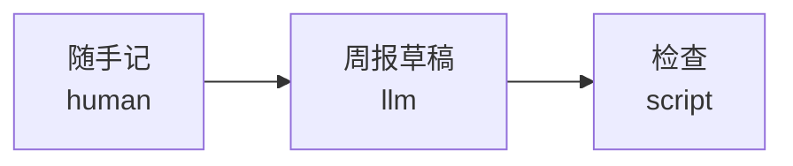

# 动手做一个流程 / Build your own flow

这篇教程从一个空文件夹开始，做出一个"周报"流程：你随手记下这周做的事，模型整理成周报，脚本检查格式。大约 15 分钟，不需要 API key。做完的样子是命令行自带的 `weekly-report` 模板（[源文件](../packages/cli/templates/weekly-report)），随时可以用 `flowgit init ~/my-report -t weekly-report` 建一份对照。

This tutorial starts from an empty folder and builds a "weekly report" flow: you jot down what you did this week, a model turns it into a report, and a script checks the format. About 15 minutes, no API key needed. The finished version ships with the CLI as the `weekly-report` template ([source](../packages/cli/templates/weekly-report)); run `flowgit init ~/my-report -t weekly-report` to get a copy to compare with.

## 0. 准备 / Before you start

先按根目录 README 的"快速开始"编译好 Flowgit，然后让 `flowgit` 这个命令能用：

Build Flowgit as in "Quick start" in the root README, then make the `flowgit` command available:

```bash
# macOS / Linux，在 Flowgit 仓库根目录运行 / from the Flowgit repo root
alias flowgit="node $PWD/packages/cli/dist/index.js"
```

```powershell
# Windows PowerShell，换成你自己的路径 / use your own path
function flowgit { node E:\claude_code\Flowgit\Flowgit\packages\cli\dist\index.js @args }
```

## 1. 先想清楚阶段 / Plan the stages

流程就是一串阶段。每个阶段回答三个问题：读什么、产出什么、谁来做。先在纸上写清楚，再写文件：

A flow is a list of stages. Each stage answers three questions: what it reads, what it writes, and who does it. Write it down before writing any files:

| 阶段 / Stage | 谁来做 / Who | 读 / Reads | 产出 / Writes |
| --- | --- | --- | --- |
| 随手记 `notes` | 人 / a person (`human`) | 无 / nothing | `notes.md` |
| 周报草稿 `draft` | 模型 / a model (`llm`) | `notes` | `report.md` |
| 检查 `check` | 脚本 / a script (`script`) | `draft` | `check.json` |

几个经验：

- **每个阶段只做一件事，产出一个看得懂的文件。** 产物就是卡片上展示、可以手改、可以回退的东西。
- **人最擅长的地方留给人。** 素材、审稿、拍板这类事用 `human` 阶段，流程会停下来等你。
- **能用脚本检查的就别靠肉眼。** 检查阶段失败时，流程会停在那里，你改了再跑。

A few rules of thumb:

- **One job per stage, one readable output.** The output is what the card shows, what you can edit by hand and what you can roll back.
- **Leave to people what people do best.** Use a `human` stage for assets, reviews and decisions; the flow stops and waits for you.
- **Check with a script instead of by eye.** When a check stage fails, the flow stops there until you fix things and run it again.

## 2. 写 flow.json / Write flow.json

```bash
mkdir -p ~/weekly-report/prompts ~/weekly-report/scripts
cd ~/weekly-report
# PowerShell: mkdir ~\weekly-report\prompts, ~\weekly-report\scripts; cd ~\weekly-report
```

新建 `flow.json`：

Create `flow.json`:

```json
{
  "format": "flowgit",
  "version": "0.1",
  "id": "weekly-report",
  "name": "周报",
  "inputs": {
    "name": { "type": "string", "description": "你的名字", "required": true },
    "language": { "type": "string", "enum": ["zh", "en"], "default": "zh" }
  },
  "stages": [
    {
      "id": "notes",
      "name": "随手记",
      "executor": { "type": "human", "instructions": "把这周的事随手写进 notes.md，一行一件" },
      "outputs": [{ "type": "text/markdown", "path": "notes.md" }]
    },
    {
      "id": "draft",
      "name": "周报草稿",
      "inputs": ["notes"],
      "executor": { "type": "llm", "prompt": "prompts/draft.md" },
      "outputs": [{ "type": "text/markdown", "path": "report.md" }]
    },
    {
      "id": "check",
      "name": "检查",
      "inputs": ["draft"],
      "executor": { "type": "script", "run": "node scripts/check.mjs" },
      "outputs": [{ "type": "application/json", "path": "check.json" }]
    }
  ]
}
```

要点：

- `inputs`（最外层）是**流程输入**：开始前填一次的参数。`required` 的不填就不能运行，`enum` 限定可选的值。
- 阶段里的 `inputs` 是**上游阶段**的 id。`draft` 写了 `["notes"]`，就会读到 `notes.md`，而且 `notes.md` 一变，`draft` 和它后面的阶段都会被标成需要重跑。
- `outputs` 的 `type` 决定下游怎么用它：`text/*` 和 JSON 会把内容直接交给下游的模型，其他文件只给路径。

Key points:

- The top-level `inputs` are **flow inputs**: parameters filled in once before you start. A `required` input must be set before anything runs; `enum` limits the allowed values.
- A stage's `inputs` are **upstream stage** ids. `draft` lists `["notes"]`, so it reads `notes.md`, and whenever `notes.md` changes, `draft` and everything after it are marked as needing a re-run.
- An output's `type` decides how downstream stages see it: `text/*` and JSON are passed to a downstream model as content; other files are passed as paths.

字段的完整说明见 [spec.md](spec.md)。/ Every field is described in [spec.md](spec.md).

### 用命令加阶段 / Add a stage from the command line

已经有 `flow.json` 时，不必手改文件。下面这条把「润色」插在「周报草稿」后面，并新建 `prompts/polish.md`（文件已存在就不会覆盖）：

Once `flow.json` exists, you don't have to edit it by hand. This inserts a "polish" stage after the draft and creates `prompts/polish.md` (an existing file is left as it is):

```bash
flowgit stage add polish --type llm --name 润色 --after draft
flowgit validate
```

不写 `--after` 就加在最后；不写 `--input` 就把前一个阶段当作输入。`human` 和 `llm` 的默认产物是 `<id>.md`，`agent` 是 `<id>/` 目录，`script` 必须写 `--run` 和 `--output`。

Omit `--after` to append the stage, and omit `--input` to use the stage before it as the input. `human` and `llm` default to an output of `<id>.md`, `agent` defaults to a directory `<id>/`, and `script` requires `--run` and `--output`.

删掉一个阶段不会删除它的文件，也不会动 `runs/`。如果后面的阶段还把它当作输入，命令会拒绝，并列出那些阶段；确认后加 `--force` 会去掉这些引用。试完用下面这条删掉「润色」，后面的教程还是三个阶段：

Removing a stage deletes none of its files and does not touch `runs/`. If later stages still use it as an input, the command refuses and lists them; `--force` drops those references. When you're done trying it, remove "polish" with the line below so the rest of the guide still has three stages:

```bash
flowgit stage rm polish
```

## 3. 写提示词 / Write the prompt

新建 `prompts/draft.md`：

Create `prompts/draft.md`:

```markdown
把随手记整理成 {{inputs.name}} 的周报，用 {{inputs.language}} 写（zh 中文，en English）。

- 第一行是标题，然后正好三个小节：`## 本周完成`、`## 下周计划`、`## 需要帮助`（英文用 `## Done this week`、`## Next week`、`## Need help`）。
- 每节 1 到 5 条要点。随手记里没有的事不要编，没内容就写"暂无"。
- 只输出周报本身。
```

`{{inputs.name}}` 会换成流程输入的值。上游产物（这里是 `notes.md` 的内容）Flowgit 会自动附在提示词后面，不用自己写。模型的回复就是 `report.md`。

`{{inputs.name}}` is replaced with the flow input's value. Flowgit appends the upstream artifacts (here, the content of `notes.md`) to the prompt for you. The model's reply becomes `report.md`.

## 4. 写检查脚本 / Write the check script

`script` 阶段在流程目录里执行一条命令。Flowgit 通过环境变量告诉脚本该读什么、该写什么。新建 `scripts/check.mjs`：

A `script` stage runs a command in the flow directory. Flowgit tells the script what to read and write through environment variables. Create `scripts/check.mjs`:

```js
import fs from "node:fs";

// Flowgit passes the stage's files and the flow inputs in environment variables.
const [report] = JSON.parse(process.env.FLOWGIT_INPUTS);   // [{ stage, path, type }]
const [out] = JSON.parse(process.env.FLOWGIT_OUTPUTS);     // [{ path, type }]
const { language } = JSON.parse(process.env.FLOWGIT_FLOW_INPUTS);

const text = fs.readFileSync(report.path, "utf8");
const sections = language === "en" ? ["Done this week", "Next week", "Need help"] : ["本周完成", "下周计划", "需要帮助"];
const missing = sections.filter((s) => !text.includes(`## ${s}`));

fs.writeFileSync(out.path, JSON.stringify({ ok: missing.length === 0, missing }, null, 2));
if (missing.length) {
  console.error(`缺少小节 / missing sections: ${missing.join(", ")}`);
  process.exit(1); // a non-zero exit marks the stage as failed
}
console.log("✓ 三个小节都在 / all three sections are there");
```

脚本退出码不是 0，这个阶段就算失败，流程停在这里。脚本本身也算进"执行器配置"：改了 `scripts/check.mjs`，检查阶段就会被标成需要重跑。

A non-zero exit fails the stage and the flow stops there. The script counts as part of the executor config: change `scripts/check.mjs` and the check stage is marked as needing a re-run.

## 5. 检查并运行 / Validate and run

```bash
flowgit validate                 # 按规范检查 flow.json / check flow.json against the spec
flowgit inputs set name="小林"     # 存进 flowgit.local.json / saved in flowgit.local.json
flowgit status
```

```text
周报 · flow.json v0.1 · /home/me/weekly-report

#  阶段 stage      执行 executor  状态 state                   版本 runs  产物 outputs
1  随手记 notes    human          ○ 可以运行 (never-run)       -          notes.md
2  周报草稿 draft  llm            … 等上游 (waiting-upstream)  -          report.md
3  检查 check      script         … 等上游 (waiting-upstream)  -          check.json

下一步：「随手记」需要你来做。Next: "notes" is yours.
  把这周的事随手写进 notes.md，一行一件
  完成后运行 / then run: flowgit run notes
```

第一个阶段是人做的。把这周的事写进 `notes.md`（或者 `flowgit run notes --from 别处的文件.md`），然后：

The first stage is yours. Write this week's work into `notes.md` (or use `flowgit run notes --from some-other-file.md`), then:

```bash
flowgit run notes
```

接下来轮到模型。先不花钱试跑：自己写一个"假回复"，Flowgit 会用它代替模型。新建 `demo-replies/draft.md`（文件名就是阶段 id），内容随便写一份符合格式的周报，然后：

Next is the model. To try it for free first, write a fake reply and Flowgit will use it instead of calling a model. Create `demo-replies/draft.md` (the file name is the stage id) with any report in the right format, then:

```bash
FLOWGIT_LLM_MOCK_DIR=demo-replies flowgit run all
# PowerShell: $env:FLOWGIT_LLM_MOCK_DIR="demo-replies"; flowgit run all; Remove-Item Env:FLOWGIT_LLM_MOCK_DIR
```

```text
· 随手记 (notes) 跳过 / skipped: 已是最新 / up to date
▶ 周报草稿 (draft, llm)
    调用 / calling claude-opus-5-5 (anthropic, prompt 291 chars)
    实际由 mock:draft.md 回复 / served by mock:draft.md
    已写入 / wrote report.md (184 chars, 0 ms)
✓ 周报草稿 → runs/draft/1/
▶ 检查 (check, script)
    $ node scripts/check.mjs
    ✓ 三个小节都在 / all three sections are there
✓ 检查 → runs/check/1/

✓ 处理了 2 个阶段 / ran 2 stage(s)
```

换成真的模型之前，可以先用 `flowgit doctor` 看看还缺什么。它检查 Node、流程输入、密钥，以及脚本和 agent 要用的命令有没有装好；不调用模型，也不运行任何阶段：

Before switching to a real model, `flowgit doctor` shows what is still missing. It checks Node, the flow inputs, keys, and whether the programs script and agent stages use are installed; it calls no model and runs no stage:

```bash
flowgit doctor --model deepseek/deepseek-v4-pro
```

```text
周报 · 检查运行环境 / checking what this flow needs

  ✓ Node.js 22.23.4
  ✓ 流程输入都填好了 / flow inputs are set
  ✗ draft: 模型 deepseek/deepseek-v4-pro 的密钥 DEEPSEEK_API_KEY 没有设置 / key DEEPSEEK_API_KEY for model deepseek/deepseek-v4-pro is not set
      PowerShell：$env:DEEPSEEK_API_KEY="..."；macOS/Linux：export DEEPSEEK_API_KEY=...
      或者先用示例回复试跑 / or try the canned replies first: FLOWGIT_LLM_MOCK_DIR=demo-replies
  ✓ check: 找到 / found node

✗ 1 个问题要先解决 / 1 problem(s) to fix first
```

想知道 `run all` 会跑哪些阶段、调用几次模型，就加 `--dry-run` 预演一下。它什么都不运行，也不调用模型。比如在 `notes.md` 里补了一行之后：

To see which stages `run all` would run and how many model calls it would make, add `--dry-run`. It runs nothing and calls no model. For example, after adding a line to `notes.md`:

```bash
flowgit run all --dry-run --model deepseek/deepseek-v4-pro
```

```text
预演：不会运行任何阶段 / dry run: nothing runs

#  阶段 stage      会怎样 action                        详情 details
1  随手记 notes    ✎ 保留你的手动修改 / keep your edit
2  周报草稿 draft  ▶ 运行 / run                         模型 / model deepseek/deepseek-v4-pro
3  检查 check      ▶ 运行 / run                         node scripts/check.mjs

最多 1 次模型调用 / at most 1 model call(s)（上游产物没变的阶段到时会跳过 / stages whose upstream output comes out the same are skipped）
真的运行 / to run it: flowgit run all --model deepseek/deepseek-v4-pro
```

用真的模型：设好密钥，去掉 `FLOWGIT_LLM_MOCK_DIR`，再跑一次。默认是 Claude（`ANTHROPIC_API_KEY`）；想用别的模型，加 `--model`，或者在阶段里写 `"model"`：

With a real model: set a key, drop `FLOWGIT_LLM_MOCK_DIR` and run again. The default is Claude (`ANTHROPIC_API_KEY`); for another model pass `--model` or set `"model"` on the stage:

```bash
export DEEPSEEK_API_KEY=...                    # PowerShell: $env:DEEPSEEK_API_KEY="..."
flowgit run draft --force --model deepseek/deepseek-v4-pro
flowgit run all
```

`flowgit providers` 列出所有能用的模型供应商，以及密钥有没有设置。/ `flowgit providers` lists every model provider and whether its key is set.

## 6. 修改、重跑、回退 / Edit, re-run, roll back

这是 Flowgit 和"一键生成"最不一样的地方。

This is where Flowgit differs most from one-click generators.

**改上游，下游自动标出来。** 在 `notes.md` 里加一行，再看 `flowgit status`：

**Change something upstream and downstream is marked.** Add a line to `notes.md`, then look at `flowgit status`:

```text
#  阶段 stage      执行 executor  状态 state                          版本 runs  产物 outputs
1  随手记 notes    human          ✎ 产物被手动修改 (edited)           v1         notes.md
2  周报草稿 draft  llm            ↻ 需重跑（上游或配置变了） (stale)  v1         report.md
3  检查 check      script         ↻ 需重跑（上游或配置变了） (stale)  v1         check.json
```

改提示词也一样：`prompts/draft.md` 改一个字，草稿和检查都会变成"需重跑"。`flowgit run all` 只重跑需要重跑的阶段。

Editing the prompt works the same way: change one word in `prompts/draft.md` and both draft and check become stale. `flowgit run all` re-runs only what needs it.

**手改的东西不会丢。** 直接改 `report.md` 也没关系。下次重跑这个阶段前，Flowgit 会先把你的修改存成一个版本：

**Hand edits are never lost.** Edit `report.md` directly if you like. Before the stage runs again, Flowgit saves your edit as its own version:

```text
    你的手动修改已存为 v2 / your manual edit was saved as v2
```

**每个版本都能看、能回退。**

**Every version can be inspected and restored.**

```bash
flowgit log draft
```

```text
周报草稿 (draft) · 3 个版本 / run(s)

版本 v  结果 status  完成时间 finished    执行 executor  详情 details
v3      ok           2026-11-01 16:10:30  llm            mock:draft.md
v2      ok           2026-11-01 16:10:30  manual
v1      ok           2026-11-01 16:10:29  llm            mock:draft.md

快照 / snapshots: runs/draft/<n>/outputs/   对比 / diff: flowgit diff draft <a> [b]   回退 / restore: flowgit restore draft <n>
```

不写阶段，`flowgit log` 会按时间列出整个流程的所有版本，最新的在最上面。调用过真实模型的话，最后还会加一行 token 合计。

Without a stage, `flowgit log` lists every version of the whole flow by time, newest first. When real models were called, it ends with a token total.

```text
周报 · 6 个版本 / run(s)

完成时间 finished    阶段 stage      版本 v  结果 status  执行 executor  详情 details
2026-11-01 17:52:17  周报草稿 draft  v3      ok           llm            mock:draft.md
2026-11-01 17:52:17  周报草稿 draft  v2      ok           manual
2026-11-01 17:52:17  随手记 notes    v2      ok           manual
2026-11-01 17:52:16  检查 check      v1      ok           script         node scripts/check.mjs
2026-11-01 17:52:16  周报草稿 draft  v1      ok           llm            mock:draft.md
2026-11-01 17:52:15  随手记 notes    v1      ok           human          from

一个阶段的历史 / one stage: flowgit log <stage>
```

想知道两个版本差在哪，用 `flowgit diff`。文本和 JSON 按行显示改动（`+` 是新加的，`-` 是删掉的），图片和视频只说相同还是不同，文件夹列出新增、删除和改动的文件：

To see what changed between two versions, use `flowgit diff`. Text and JSON show changed lines (`+` added, `-` removed), images and video only say same or different, and folders list added, removed and changed files:

```bash
flowgit diff draft 1 2           # v1 和 v2 比 / v1 against v2
flowgit diff draft 2             # v2 和现在的文件比 / v2 against the current files
```

```bash
flowgit restore draft 2          # 回到你手改的那一版 / back to your hand-edited version
flowgit run all                  # 下游会重跑 / downstream re-runs
```

回退之前，如果现在的 `report.md` 又被你改过、和哪个版本都不一样，Flowgit 会先把它存成一个版本。回退到的版本本来就存着，所以草稿不会显示"手动修改"，`run all` 只重跑下游的检查。

Before a restore, if `report.md` holds a new edit that matches no version, Flowgit saves it as a version first. The restored version is already saved, so the draft doesn't show as edited and `run all` re-runs only the downstream check.

**也可以在浏览器里做。** `flowgit board` 打开本机看板（只监听 `127.0.0.1`）：每个阶段一张卡，顶部也可以换成流程图。可以看和改产物、填流程输入、运行、看历史、对比和回退，也可以新增和删除阶段，和上面的命令效果一样。

**Or do it in the browser.** `flowgit board` opens a local board (listening on `127.0.0.1` only): one card per stage, or a flow graph from the toggle at the top, where you can view and edit outputs, fill in flow inputs, run, browse history, compare and restore, and add or remove stages, with the same effect as the commands above.

```bash
flowgit board                    # 加 --no-open 不自动打开浏览器 / add --no-open to skip opening a browser
```

每个版本的文件快照在 `runs/<阶段>/<版本>/outputs/`，运行记录（用了哪个模型、花了多少 token、读了哪些上游文件）在同一个文件夹的 `run.json` 里。

Each version's file snapshot is in `runs/<stage>/<n>/outputs/`, and the run record (which model, how many tokens, which upstream files) is in `run.json` in the same folder.

## 7. 换人做：模型、agent 或人 / Swap who does a stage

阶段由谁来做只是 `executor` 这一行，换掉它，流程其他部分不用动：

Who does a stage is just the `executor` line. Swap it and the rest of the flow stays the same:

```jsonc
// 指定模型 / pick a model
"executor": { "type": "llm", "prompt": "prompts/draft.md", "model": "glm/glm-5.3" }

// 交给一个 agent，它自己在流程目录里写出 report.md / hand it to an agent that writes report.md itself
"executor": { "type": "agent", "agent": "claude-code", "prompt": "prompts/draft.md" }

// 自己写 / write it yourself
"executor": { "type": "human", "instructions": "照随手记写好 report.md" }
```

agent 的权限和安全说明见 [spec.md 的 agent 执行器](spec.md#agent-执行器--the-agent-executor)，完整的 agent 示例见 [`examples/agent-page`](../examples/agent-page)。

For agent permissions and safety, see [the agent executor in spec.md](spec.md#agent-执行器--the-agent-executor); a full agent example is [`examples/agent-page`](../examples/agent-page).

## 8. 分享 / Share it

模板和项目是同一个格式。要分享给别人，只留下 `flow.json`、`prompts/`、`scripts/`（和 `demo-replies/`、README），不要带上：

A template and a project are the same format. To share the flow, keep `flow.json`, `prompts/`, `scripts/` (plus `demo-replies/` and a README), and leave out:

- `runs/`：你的历史版本 / your version history
- `flowgit.local.json`：你填的输入值 / your input values
- 各阶段的产物（`notes.md`、`report.md`、`check.json`）/ the stage outputs

别人拿到这个文件夹后，用它新建自己的流程。从本地目录或 Git 地址复制时，默认不带上各阶段的产物；要连产物一起拿，加 `--with-outputs`。从 Git 复制时，新的 `flow.json` 会记下 `forkedFrom`（地址、分支、提交号）；从本地目录复制不写，免得把本机路径带出去。

Others start their own copy from the folder. Copying a local directory or a Git URL leaves stage outputs behind unless you pass `--with-outputs`. A Git copy records `forkedFrom` (URL, branch, commit) in the new `flow.json`; a local directory does not, so a path that may contain a user name is never stored.

```bash
flowgit init ~/my-report -t path/to/weekly-report
flowgit init ~/their-flow -t https://github.com/example/their-flow.git --ref main
```

### 分享前检查 / Check before you share

`flowgit share <目录>` 用同一套规则挑文件（默认不带产物，`runs/`、`flowgit.local.json`、`.env*` 永远不带），复制之前先扫一遍文本。像密钥的字符串会让命令停下来，一个文件都不写；邮箱和本机用户路径（`C:\Users\…`、`/Users/…`、`/home/…`）只会列出来提醒你看一眼。预览只显示前 4 个字符。

`flowgit share <dir>` picks files the same way (no outputs by default, and never `runs/`, `flowgit.local.json` or `.env*`) and scans the text before copying. A key-like string stops the command and writes nothing; email addresses and local user paths (`C:\Users\…`, `/Users/…`, `/home/…`) are listed so you can look. The preview shows only the first 4 characters.

```bash
flowgit share ~/weekly-report-public
# 目录不是空的时 / when the directory is not empty:
flowgit share ~/weekly-report-public --force
```

还可以生成一个 `SKILL.md`，让 Claude Code 这类会读 Skill 的工具不用界面也能按阶段跑：

You can also generate a `SKILL.md`, so tools that read Skills, such as Claude Code, can run the flow stage by stage without a UI:

```bash
flowgit export-skill -o SKILL.md
```

想在 README 里放一张流程图，用 `flowgit graph --md`。它输出一段 Mermaid 代码块，GitHub、GitLab 和 Obsidian 都会直接画成图：

To put a diagram of the flow in the README, use `flowgit graph --md`. It prints a Mermaid code block that GitHub, GitLab and Obsidian draw as a diagram:

````console
$ flowgit graph --md

````

加 `--status` 会按每个阶段现在的状态上色（已完成是绿色，需重跑是黄色），适合贴进进度笔记。

Add `--status` to color each stage by its current state (green when done, amber when it needs a re-run), which suits a progress note.

要存成文件，用 `--out`（`-o`）。写成 `.md` 时会自动包上代码块，而且总是 UTF-8。Windows PowerShell 5 里用 `>` 重定向会写成 UTF-16，GitHub 显示不出来，所以在 Windows 上请用 `--out`：

To save it to a file, use `--out` (`-o`). A `.md` file gets the code block automatically, and the file is always UTF-8. In Windows PowerShell 5, redirecting with `>` writes UTF-16, which GitHub can't show, so on Windows use `--out`:

```bash
flowgit graph --status --out flow.md
```

## 常见问题 / Troubleshooting

| 看到 / You see | 怎么办 | What to do |
| --- | --- | --- |
| `里没有 flow.json` / `No flow.json in …` | 命令要在流程目录里运行：先 `cd` 进去，或者加 `-C <流程目录>`；还没有流程就先 `flowgit init` | Run commands inside the flow directory: `cd` into it or add `-C <flow dir>`; with no flow yet, start with `flowgit init` |
| `flowgit validate` 报错 | 按提示改 `flow.json`。常见的是阶段 id 写错、`inputs` 里引用了不存在的阶段、两个阶段产出同一个路径、阶段之间成环 | Fix `flow.json` as the message says. Common causes: a typo in a stage id, `inputs` naming a stage that doesn't exist, two stages writing the same path, or a cycle |
| 缺少流程输入 / missing flow inputs | `flowgit inputs set 名字=值` 存下来，或者只这一次用 `--input 名字=值` | Save it with `flowgit inputs set key=value`, or pass `--input key=value` for one run |
| 「随手记」在等你 / waiting for you | 人工阶段的产物还没放好。写好文件后 `flowgit run <阶段>` | A human stage's output isn't there yet. Write it, then `flowgit run <stage>` |
| 不知道还缺什么 / not sure what's missing | 运行 `flowgit doctor`，它会列出缺的密钥、命令和 agent，以及怎么补上 | Run `flowgit doctor`: it lists missing keys, programs and agents, and how to fix each |
| 没有找到 API 凭据 / no credentials | 设置对应供应商的密钥变量（`flowgit providers` 能看到是哪个），或者先用 `FLOWGIT_LLM_MOCK_DIR` 试跑 | Set the provider's key variable (`flowgit providers` shows which), or try it first with `FLOWGIT_LLM_MOCK_DIR` |
| 余额不足 / Insufficient balance；请求太频繁 / Rate-limited | 到供应商的控制台充值或检查用量上限。Flowgit 已经自动重试过几次 | Top up or check your limits in the provider's console. Flowgit has already retried a few times |
| 连不上这个地址 / Could not reach it | 需要代理的话，同时设置 `HTTPS_PROXY` 和 `NODE_USE_ENV_PROXY=1` | If you need a proxy, set both `HTTPS_PROXY` and `NODE_USE_ENV_PROXY=1` |
| 脚本阶段失败 / a script stage failed | 看 `flowgit log <阶段>` 和 `runs/<阶段>/<版本>/run.json` 里的 `log`。改好产物或脚本后再跑 | Read `flowgit log <stage>` and the `log` in `runs/<stage>/<n>/run.json`. Fix the output or the script and run again |

做出了好用的流程？欢迎用 [流程想法](https://github.com/cgold9820-dotcom/Flowgit/issues/new?template=flow_idea.yml) 告诉我们，或者直接开 PR 放进 `examples/`（只在仓库里的示例）或 `packages/cli/templates/`（随命令行一起安装的模板）。

Made a flow that works well? Tell us with a [flow idea](https://github.com/cgold9820-dotcom/Flowgit/issues/new?template=flow_idea.yml), or open a PR adding it to `examples/` (repo-only examples) or `packages/cli/templates/` (templates installed with the CLI).
